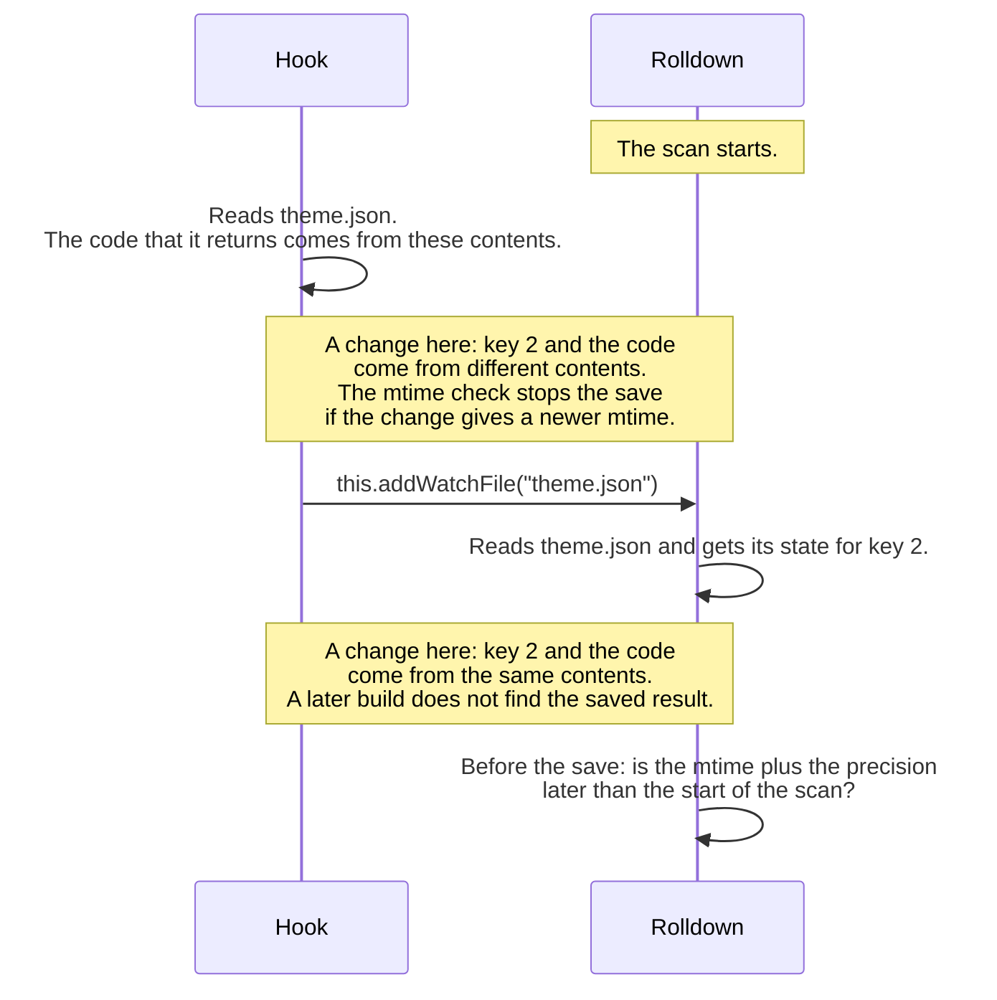

# Restart Validation

## Why this is needed

A persistent cache survives a process restart. A file watcher attached to the
process does not observe changes while that process is stopped. Before reusing
cached work, Rolldown needs to check whether its inputs still match.

For example, a plugin transforms `a.ts` using `theme.json`:

```javascript
transform(code, id) {
  this.addWatchFile("theme.json");
  return convert(code, readTheme());
}
```

If `theme.json` changes while Rolldown is stopped, the saved result may be stale
even though `a.ts` has not changed.

Restart Validation is how Rolldown detects such a change.

## Proposed approach

Use content hashes to detect file changes across restarts.

The state of a tracked file is one of two values:

- "missing", if no file exists at the path;
- the content hash of the file, if it exists.

Rolldown reads the file to get its state. In one scan, Rolldown reads each
tracked file once, even if multiple modules depend on it. A module file is
the one exception. See [Changes during a build](#changes-during-a-build).

The persistent scan cache uses the state as an input of its keys. See
[Keys](0002-persistent-scan-cache.md#keys). A file that was created, deleted,
or changed has another state. The key then changes, and the saved result is a
cache miss. Rolldown does not save the state of a file to compare it later.
The only saved fact about a file that Rolldown checks later is whether an
import resolved to a file. See
[a resolved file that is gone](0002-persistent-scan-cache.md#what-a-saved-result-holds).

## Changes during a build

Status: `decided`.

Key 2 of a [saved result](../glossary.md) holds the state of each
[transform dependency](../glossary.md) of the module. The state of a file is
the content hash of the file, or "missing" if no file exists at the path. See
[Proposed approach](#proposed-approach).

A transform dependency can change while a build runs. Without a check, the
code and key 2 of a saved result can then come from different contents:

1. A hook reads the file. The code that the hook returns comes from these
   contents.
2. The file changes.
3. Rolldown reads the file to get its state for key 2. It gets the state of
   the new contents.
4. Rolldown saves the code under this key 2. The code comes from the old
   contents, but key 2 holds the state of the new contents.

A later build finds this saved result, because the file has the new
contents. It then reuses code made from the old contents.

**Two reads of one file.** The problem comes from two reads of the same
file:

- The hook's read gives the code. Rolldown does not see this read.
- Rolldown's read gives the state for key 2.

Rolldown handles a change of the file in two ways:

- **A change after both reads.** Key 2 and the code come from the same
  contents. A later build gets the state of the changed file, so it does not
  find this saved result.
- **A change between the two reads.** Either read can come first, as
  explained below. Key 2 and the code come from different contents. The
  `mtime` check stops the save, except in the cases at the end of this
  section that are not detected.

The diagram shows a hook that reads the file before it registers it:



**When Rolldown gets the state.** A file is registered in one of two ways:

- a `load` or `transform` hook calls `this.addWatchFile`;
- Rolldown adds the file itself, as it does for the tsconfig of a module.

When the file is registered, Rolldown gets its state. Key 2 of the saved
result uses this state. If the scan has not read the file yet, Rolldown
reads it at the registration. If the scan already read it, Rolldown uses the
state from that earlier read. See [Proposed approach](#proposed-approach).
For example, a lookup has already read the file to compute key 2, or another
module has already registered the file.

So Rolldown's read can come before or after the hook's read:

- **The hook reads the file first.** A change between the two reads gives
  key 2 the state of the new contents and the code of the old contents. A
  later build with the new contents would reuse the wrong code.
- **Rolldown reads the file first.** This happens when the hook registers the
  file before it reads it, as in the example in
  [Why this is needed](#why-this-is-needed). It also happens when the scan
  already read the file. A change between the two reads gives key 2 the
  state of the old contents and the code of the new contents. A later build
  with the new contents does not find this saved result. Only a later build
  in which the file has the old contents again, for example after an undo or
  a `git checkout`, would reuse the wrong code.

**The `mtime` check.** Before Rolldown saves anything for a module, it
compares the modification time (`mtime`) of each transform dependency of the
module with the time when the scan started. Rolldown adds the precision of
the file system's timestamps to the `mtime`. If the sum is later than the
start of the scan, Rolldown saves nothing for the module. When the change
gives the file a newer `mtime`, this stops the save in both orders above.

For example, Vite's CSS plugin first compiles a Sass file. Sass reads the
files that this file imports. Vite registers these files only after the
compilation ends, so the hook reads each file first. A change to one of
these files after Sass reads it and before Vite registers it is a change
between the two reads. The `mtime` check stops this save.

Rolldown estimates the precision as webpack's `applyMtime` does. See
[Timestamp safety windows](#timestamp-safety-windows). The precision starts
at 2 seconds. Each `mtime` that Rolldown reads can lower it:

- to 1 second, if the `mtime` is not a multiple of 2 seconds;
- to 100 ms, if it is not a multiple of 200 ms;
- to 10 ms, if it is not a multiple of 20 ms;
- to 1 ms, if it is not a multiple of 2 ms.

**The module file.** The `mtime` check also covers the module file when a
`load` hook gives its code. Key 1 holds the content hash of the module file,
unless its path matches `assumeUnchanged`. See
[Files under `assumeUnchanged` paths](0002-persistent-scan-cache.md#files-under-assumeunchanged-paths).
When Rolldown loads the module itself, it reads the file once and uses the
same contents for key 1 and for the code. It reads the module file again
even if the scan already read it as a transform dependency of another
module. This way key 1 and the code come from one read. A module that
registers the file later uses the state from this read.

When the path does not match `assumeUnchanged` and a `load` hook gives the
code, the file is read two times:

1. Rolldown reads the file before any hook runs, to compute key 1.
2. The `load` hook reads the file again by itself. The code comes from this
   read.

Rolldown reads the file first, as in the second order above. If the file
changes between the two reads, the `mtime` check stops the save. If the
change does not give the file a newer `mtime`, only a later build in which
the file has the old contents again would reuse the wrong code.

**Example.** The `transform` hook of `a.ts` reads the old contents of
`theme.json`, so the code that it returns comes from the old contents.
Before Rolldown saves anything for `a.ts`, the user writes new contents to
`theme.json`. The `mtime` of `theme.json` is then later than the start of the
scan, so Rolldown saves nothing for `a.ts`.

**The two cases below assume that the write did not give `theme.json` a newer
`mtime`.** The contents changed, but the `mtime` does not show it. For
example, the write kept the old `mtime`, as in verification case 5. Then the
`mtime` check does not stop the save, and the outcome depends on when the
write comes:

- The hook reads `theme.json` and registers it, and Rolldown reads it. Then
  the user writes the new contents. Key 2 and the code come from the old
  contents. After a restart, `theme.json` has the state of the new contents,
  so `a.ts` runs its hooks again. This is correct.
- The hook reads `theme.json`. Then the user writes the new contents. Then
  the hook registers `theme.json`, and Rolldown reads it for the first time
  in this scan. Key 2 holds the state of the new contents, but the code comes
  from the old contents. A later build finds this saved result and reuses
  it, which is wrong. This is the second case in the list of cases that are
  not detected, below.

**What a wrong `mtime` can do.** The `mtime` decides only one thing: whether
Rolldown saves anything for the module. Key 2 holds the state of each file,
not its `mtime`, and a lookup reads the files. So a wrong `mtime` never
makes the cache worse than it would be without the `mtime` check:

- An `mtime` that is too old does not stop the save. The outcome is the same
  as without the `mtime` check.
- An `mtime` that is too new makes Rolldown skip a save. The next build runs
  the hooks again.

The timestamp check in [Future work](#future-work) uses the `mtime` in a
different way. It would treat a file as unchanged when its `mtime` and size
match, and skip reading it. Future work says why that check must be opt-in.

These cases are not detected:

- A transform dependency that exists when a hook reads it and is deleted
  before Rolldown reads it. Its state is "missing", and it has no `mtime` to
  compare.
- A change between the two reads, when the write does not give the file a
  newer `mtime`. When Rolldown reads the file first, this gives a wrong
  result only if the file later gets the old contents again.

## Research: bundlers and task executors

These observations describe the inspected implementations, not guarantees for
every release or file type. Bazel is included as a build-system reference.

| System | Restart validation | Tradeoff |
| --- | --- | --- |
| webpack | Dependency snapshots. Module snapshots default to timestamps in development and timestamps plus hashes in production. Uses a safety window for timestamp precision. | Passing timestamp checks avoid content reads, but rely on timestamp behavior. |
| Turbopack | File reads are session-dependent tasks. A new session rereads files and compares results against persisted hashes. | Reads inputs again; unchanged results can avoid downstream recomputation. |
| Parcel v2 | Saves a watcher snapshot and queries changes since that snapshot. FSEvents and Watchman provide historical queries; traversal backends compare paths and mtimes. | Cost and detection behavior depend on the backend. |
| Parcel v3 branch | The inspected startup path creates new build state and supports in-process incremental updates. No persistent build-cache restoration path was found. | No restart-validation strategy confirmed in the inspected revision. |
| Bazel | Obtains input digests and uses them to validate action-cache entries. Existing digests may be available; otherwise it reads files to compute them. | Fast digest access requires support that ordinary local files may not have. |

### Sources

- **webpack:** [snapshot defaults](https://github.com/webpack/webpack/blob/main/lib/config/defaults.js), [`applyMtime()` and validation](https://github.com/webpack/webpack/blob/main/lib/FileSystemInfo.js).
- **Turbopack:** [session-dependent reads](https://github.com/vercel/next.js/blob/cfa2956c852b226de09213513196510165def4ea/turbopack/crates/turbo-tasks-fs/src/disk.rs#L881-L910),  [`FileContent` persistence](https://github.com/vercel/next.js/blob/cfa2956c852b226de09213513196510165def4ea/turbopack/crates/turbo-tasks-fs/src/content.rs#L77-L96).
- **Parcel v2:** [`loadRequestGraph()`](https://github.com/parcel-bundler/parcel/blob/v2/packages/core/core/src/RequestTracker.js#L1443-L1483), [watcher backends](https://github.com/parcel-bundler/watcher#querying), [directory comparison](https://github.com/parcel-bundler/watcher/blob/master/src/DirTree.cc#L122-L141).
- **Parcel v3:** [startup and watch loop](https://github.com/parcel-bundler/parcel/blob/d290a66d4252cc1df81bf620ba852ed63a69a957/crates/parcel/src/lib.rs#L46-L84).
- **Bazel:** [digest acquisition](https://github.com/bazelbuild/bazel/blob/master/src/main/java/com/google/devtools/build/lib/vfs/DigestUtils.java#L152-L190), [`ActionCacheChecker::isUpToDate()`](https://github.com/bazelbuild/bazel/blob/master/src/main/java/com/google/devtools/build/lib/actions/ActionCacheChecker.java#L197-L256).

### Timestamp safety windows

webpack uses `safeTime = mtime + estimated precision` to account for changes that may share the same timestamp. It trusts a matching timestamp only if `safeTime` is no later than the previous build’s start time.

This still relies on a sufficient precision estimate and does not detect content changes that preserve an old timestamp. [Source](https://github.com/webpack/webpack/blob/main/lib/FileSystemInfo.js).

## Open questions

1. The hash algorithm, validation timing, and whether to track file metadata remain open.

## Future work

- Directories. `this.addWatchFile` accepts a directory, and the file watcher watches everything below it. This design covers files only. How a directory is validated after a restart is not decided. It is part of [M2](../milestones.md#m2-plugin-state-and-untracked-inputs). See [rolldown/cache#14](https://github.com/rolldown/cache/issues/14) for the related `import.meta.glob` case.
- A timestamp check that skips hashing when `mtime` and `size` match, with webpack's `safeTime` rule for timestamp precision. It must be opt-in, because some writes keep the old `mtime` (verification case 5). Turning it on by default needs a way to show why a file or module was reused or not, for example a `cache inspect` command.
- Platform-specific optimizations, such as using a saved FSEvents event ID on macOS to query changes since the previous run. This needs a fallback for when event history is unavailable or incomplete.

## Verification

1. Unchanged inputs: Save a cache and restart without editing any tracked files. Expect a cache hit for every saved result.
2. Changed contents: Edit `a.ts` or its registered dependency `theme.json` while stopped. Expect a cache miss for `a.ts`.
3. Deleted files: Delete a tracked `theme.json` while stopped. Expect a cache miss for `a.ts`.
4. Previously missing files: Build `a.ts` with `theme.json` registered as a dependency but missing. Create `theme.json` while stopped, then restart. Expect a cache miss for `a.ts`.
5. Preserved `mtime`: Change `theme.json` contents, restore its original `mtime`, and restart. Expect a cache miss for `a.ts`.
6. Shared files: Register `theme.json` as a dependency of both `a.ts` and `b.ts`. Change it while stopped. Expect that Rolldown reads it once, and a cache miss for both `a.ts` and `b.ts`.
7. Changes during the build: A test plugin changes a file during the build. After each case, restart without further edits. Also run a second full build with the same bundler, as watch mode does. In each case, expect output that matches a clean build, both after the restart and in the second build. See [Changes during a build](#changes-during-a-build).
   - The `transform` hook of `a.ts` reads `theme.json`, rewrites it, and then registers it. Expect that Rolldown saves no result for `a.ts`.
   - The `transform` hook of `a.ts` reads and registers `theme.json`. After the hook, the test rewrites `theme.json` and sets its `mtime` to a time more than 2 seconds before the start of the scan. Expect that Rolldown saves a result for `a.ts`, and a cache miss for `a.ts` after the restart and in the second build.
   - A `load` hook gives the code of `a.ts` and reads `a.ts` by itself. The test rewrites `a.ts` after Rolldown reads it for key 1 and before the hook reads it. Expect that Rolldown saves no result for `a.ts`.
8. Build correctness: After editing `theme.json`, compare the output of a build using the saved cache with a clean build using the same inputs. Expect matching output.
9. Performance: Measure restart builds with no edits and with one edited file. Include validation, restoration, and cache-update costs, and compare total time with a build without saved cache.

The existing [M1 acceptance criteria](../milestones.md#m1-persistent-scan-cache) remain the delivery requirements.
