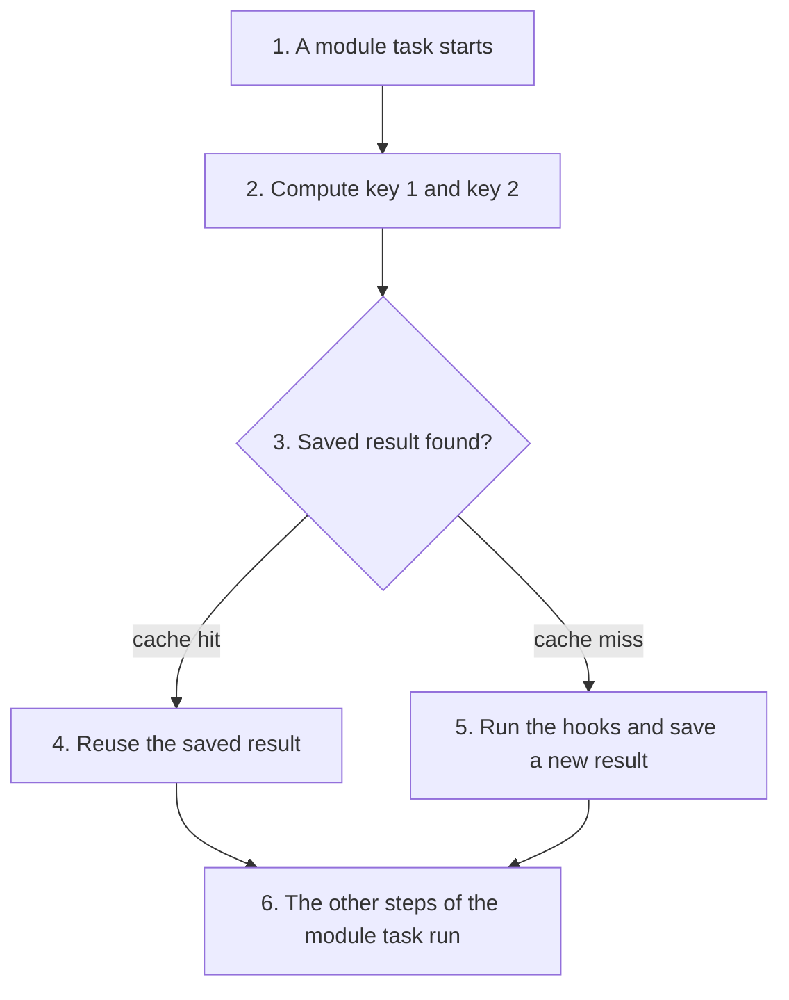
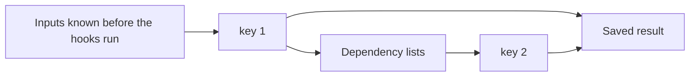

# Persistent scan cache

Rolldown keeps a scan cache in memory. [`ScanStageCache`][cache] holds a
snapshot of the scanned module graph and the maps from module id to module
index. When files change, a partial scan re-scans only the changed modules and
[`ScanStageCache::merge`][merge] splices the result into the snapshot. The
cache lives in the `Bundler` and is lost when the process stops, so every start
[begins with a full scan][full-scan].

This design saves scan results to disk and restores them on the next start in
the same worktree. A restart then skips the saved scan work for modules whose
inputs did not change while Rolldown was stopped.

Main decision (`decided`, from the [M1 goal][m1]): keep the existing
module-level incremental model. [`ScanStageCache`][cache], partial scans, and
the merge path stay as they are. They serve rebuilds inside one process and
are not saved.

The persistent cache is separate from `ScanStageCache` (`decided`). It holds
the results of the plugin hooks for each module. The first scan after a
restart is still a full scan. For a module whose inputs did not change, it
reuses these results and does not run the hooks again.
[Serialization](#serialization) defines what is saved.
[When the cache is used](#when-the-cache-is-used) defines every case in which
Rolldown reads and writes the cache.

[cache]: https://github.com/rolldown/rolldown/blob/41f7dd782/crates/rolldown/src/types/scan_stage_cache.rs#L23
[merge]: https://github.com/rolldown/rolldown/blob/41f7dd782/crates/rolldown/src/types/scan_stage_cache.rs#L123
[full-scan]: https://github.com/rolldown/rolldown/blob/41f7dd782/crates/rolldown/src/bundler/impl_bundler_incremental_build.rs#L65-L68
[m1]: ../milestones.md#m1-persistent-scan-cache

## Scope

In scope:

- Reuse of saved scan results after a restart in the same worktree.
- Changes made while Rolldown was stopped. Detecting them is defined in
  [Restart Validation](0001-restart-validation.md).
- Saving a module's scan result in a reduced form, such as its transform
  output. Reuse is still decided per module.

Out of scope:

- New cache boundaries inside the scan stage with their own keys and
  invalidation rules, such as a separate cache for `resolveId` results. See
  [M3](../milestones.md#m3-incremental-computation-granularity-and-correctness).
- Incremental work in the link and generate stages. See
  [M4](../milestones.md#m4-incremental-reuse-in-link-and-generate).
- Reuse across worktrees, project moves, or machines. See
  [M2](../milestones.md#m2-shared-scan-cache).
- Cross-platform and cross-project reuse. See [goals.md](../goals.md#non-goals).

This scope is M1's. Later milestones change this document in place where they
change its decisions, following the rules in
[AGENTS.md](../AGENTS.md#keeping-designs-current).

## Restart flow

The diagram shows the first scan after a restart. The table links each step
to the section that defines it.



| Step | Defined in |
| --- | --- |
| 2 | [Keys](#keys), [Restart Validation](0001-restart-validation.md) |
| 3 | [Keys](#keys), [Cache validity](#cache-validity) |
| 4 | [What a saved result holds](#what-a-saved-result-holds), [Side effects](#side-effects) |
| 5 | [Which modules get a saved result](#which-modules-get-a-saved-result), [Writing saved results](#writing-saved-results) |
| 6 | [What a restart skips](#what-a-restart-skips) |

## Storage and incremental writes

### Keys

Status: `decided`.

Rolldown finds the saved result of a module with two keys. Each key is a hash
of inputs. A saved result is only added, never changed. When an input
changes, a key changes, and Rolldown does not find the old saved result.



**Key 1** is a hash of these inputs. Rolldown knows all of them before it
runs a hook of the module.

| Input | Notes |
| --- | --- |
| The cache key | Rolldown puts its own version in front of the `cacheKey` that the host passes. See [Host inputs](#host-inputs). |
| The options hash | See [Options hash](#options-hash). |
| The content hash of each build dependency | See [Host inputs](#host-inputs). |
| The module id | With `experimental.importAttributes` on, it holds the import attributes. |
| The asserted module type | See the note in [What a saved result holds](#what-a-saved-result-holds). |
| The watch mode | The value that JavaScript plugins read as `this.meta.watchMode`. The JavaScript API sets it: `true` for `watch()`, `false` otherwise. |
| The content hash of the module file | Left out when the path of the file matches `assumeUnchanged`. See [Files under `assumeUnchanged` paths](#files-under-assumeunchanged-paths). |

**Why the Rolldown version is in the cache key.** A new version of Rolldown
can change the result of a module while every other input of key 1 stays the
same. For example, a new version changes the `transform` hook of a built-in
Rust plugin. Rolldown has no way to track such a change. So each Rolldown
version gets its own key 1, and a saved result from another version is not
found.

Later, Rolldown is expected to have a cache version: a number that changes
with every change to Rolldown that affects saved results. The cache version
then takes the place of the Rolldown version in the cache key, and one cache
version can serve several Rolldown versions.

**Dependency lists.** Under key 1, Rolldown saves the paths of the
[transform dependencies](../glossary.md) of the module as one list. It saves
paths only. The state of each file is not saved in the list. It is part of
key 2. A module usually has one list. The list is a result of the hooks, so
two builds with the same key 1 can give different lists. Rolldown then adds
the new list and keeps the old one.

**Key 2** is a hash of one dependency list: each path in the list, and the
current state of the file at that path. The state is "missing" or the content
hash of the file, as in [Restart Validation](0001-restart-validation.md).

**Lookup.** For a module, Rolldown computes key 1 and reads its dependency
lists, newest first. For each list it computes key 2 and looks for a saved
result under key 1 and key 2. It uses the first one it finds. This is a cache
hit. If it finds none, it is a cache miss: Rolldown runs the hooks and saves a
new result.

Key 1 and key 2 hold absolute paths, for example the module id and the paths
in a dependency list. M2 is expected to change this, because absolute paths
differ between worktrees.

For example, `a.ts` does not change, so key 1 stays the same. Its `transform`
hook reads `theme.json`.

1. **First build.** `theme.json` is `{ "extends": "./base.json" }`. The hook
   registers `theme.json` and `base.json`. Rolldown saves list 1, which holds
   these two paths and the tsconfig of `a.ts`. It saves the result under
   key 2 `d41a`.
2. **A user changes `theme.json`** to `{ "color": "red" }` while Rolldown is
   stopped.
3. **Restart.** Rolldown reads list 1 and computes key 2 from the files as
   they are now. `theme.json` changed, so key 2 is not `d41a`, and Rolldown
   finds no saved result. It runs the hooks. This time the hook registers
   only `theme.json`. Rolldown saves list 2, which holds `theme.json` and the
   tsconfig. It saves the new result under key 2 `88f0`.
4. **Next restart, no change.** Rolldown tries list 2 first. It gives `88f0`,
   and Rolldown uses that saved result.
5. **The user changes `theme.json` back.** List 2 gives a key 2 with no saved
   result. List 1 gives `d41a`, and Rolldown uses the result of the first
   build.

After step 3, key 1 holds two lists:

| List | Saved in | Paths | key 2 of its saved result |
| --- | --- | --- | --- |
| List 1 | Step 1 | `theme.json`, `base.json`, the tsconfig | `d41a` |
| List 2 | Step 3 | `theme.json`, the tsconfig | `88f0` |

#### Files under `assumeUnchanged` paths

Status: `decided`.

Rolldown skips the hash of a file whose path matches
[`assumeUnchanged`](#host-inputs):

- For a module file that matches, key 1 holds no content hash of the file.
- For a path in a dependency list that matches, key 2 holds the path only.

Rolldown decides this for each file by its own path. A build dependency is
always hashed, also when its path matches.

For example, `assumeUnchanged` is `**/node_modules/**`:

| File | Role | Matches | Rolldown |
| --- | --- | --- | --- |
| `/proj/node_modules/react/index.js` | Module file | Yes | Leaves its content hash out of key 1 |
| `/proj/src/a.ts` | Module file | No | Puts its content hash into key 1 |
| `/proj/node_modules/theme-pkg/theme.json` | Transform dependency of `a.ts` | Yes | Puts only the path into key 2 |
| `/proj/theme.json` | Transform dependency of `react/index.js` | No | Puts the path and the state into key 2 |
| `/proj/node_modules/.pnpm/lock.yaml` | Build dependency | Yes | Hashes it. The hash is part of key 1 of every module. |

### What is stored under the keys

Status: `decided`.

Under key 1 and key 2, Rolldown stores one saved result.
[Serialization](#serialization) defines its parts:

| Part | Defined in |
| --- | --- |
| The state after `transform` | [What a saved result holds](#what-a-saved-result-holds) |
| The resolve result of each import | [What a saved result holds](#what-a-saved-result-holds) |
| The side effects that Rolldown does again | [Side effects](#side-effects) |

This section adds how two of them are stored.

**Resolve results.** After a restart, Rolldown parses the code again and
finds the imports. For each import it takes the resolve result from the saved
result. So the saved result holds the resolve results as a map from a key to
a resolve result. The key is made of three values of the import, taken
together:

| Part of the key | Example | Why it is part of the key |
| --- | --- | --- |
| The specifier | `./b` | It names the module that the import asks for. |
| The import kind | `import` | Rolldown [picks the resolver by the import kind][resolver-kind], so `import` and `require` of the same specifier can give different results. |
| The import attributes | none | With `experimental.importAttributes` on, they are part of the module id of the result. |

Two imports with the same three values have the same key and share one
resolve result. Rolldown [uses the same three values today][dedup] to resolve
the same import only once. Rolldown looks a result up by its key. It does not
search a list.

The form of the key on disk is left to the implementation. Two possible
forms:

- The three values themselves.
- One hash of the three values. The hash must be wide enough that two imports
  of one module do not give the same value.

**Watched files that are not transform dependencies.** A hook other than
`load` and `transform`, such as `resolveId`, can call `this.addWatchFile`.
Rolldown then [only watches the file][native-watch]. The saved result holds
these paths, and Rolldown watches the files again when it reuses the result.
They are not in a dependency list and not part of key 2. In a rebuild, a
change to such a file does not make Rolldown resolve the import again
either: the dev engine [scans only the changed paths][partial], and the HMR
stage [takes only the modules][hmr-affected] that have the file as a
transform dependency.

An example. `a.ts` imports `./b`. A plugin named `theme` transforms `a.ts`,
registers `/proj/theme.json`, emits `theme.css`, and prints a warning. The
field names and the JSON form are for reading only. They are not the format
on disk.

```json
{
  "7c1e": {
    "dependencyLists": [
      ["/proj/theme.json", "/proj/tsconfig.json"]
    ],
    "savedResults": {
      "d41a": {
        "afterTransform": {
          "code": "import { b } from \"./b\"; export const color = \"red\";",
          "moduleType": "ts",
          "moduleSideEffects": null,
          "sourcemapChain": [{ "transform": { "plugin": 3, "map": "..." } }],
          "readFromDisk": true
        },
        "resolved": {
          "./b | import | {}": {
            "id": "/proj/src/b.ts",
            "external": false,
            "isExternalWithoutSideEffects": false,
            "packageJsonPath": "/proj/package.json",
            "moduleSideEffects": null
          }
        },
        "sideEffects": {
          "watchFiles": [],
          "emittedFiles": [
            { "type": "asset", "name": "theme.css", "source": ":root{--c:red}" }
          ],
          "moduleToFileRef": [],
          "logs": [
            { "level": "warn", "plugin": "theme", "message": "theme.json uses a deprecated field" }
          ]
        }
      }
    }
  }
}
```

`7c1e` is key 1 and `d41a` is key 2.

### Layout on disk

#### The cache directory

Status: `decided`.

The host passes the directory of the cache as `experimental.cache.dir`:

```ts
experimental: {
  cache: {
    dir: '/proj/node_modules/.vite/rolldown-cache',
  },
}
```

Rolldown keeps all cache data in this directory. A relative path is resolved
against `cwd`. Rolldown has no default directory.

`experimental.cache` also turns the cache on and off:

| `experimental.cache` | Meaning |
| --- | --- |
| not set, or `false` | The cache is off. Rolldown reads and writes no cache data. |
| an object | The cache is on. `dir` is required. |

Rolldown does not accept `true` for now. It has no default directory, so the
caller must write the complete object. A host can accept `true` in its own
config and build the object for Rolldown.

This directory is the [local cache](../glossary.md) of one worktree. M2 is
expected to add a second directory option for the global cache, because the
worktrees of a project need one directory that all of them can use.

#### Files in the cache directory

Status: `proposed`.

The direction is that one file holds many saved results, as in
[webpack][webpack-pack] and [Turbopack][turbopack-sst]. A large project has
tens of thousands of modules, and one file for each saved result would
create tens of thousands of files.

The implementation decides by benchmark which layout to keep. It can also
try a layout of Rolldown's own. Any layout must keep the rules of this
section.

The format of the files, the hash algorithm, and how Rolldown reads the
files on a restart are left to the implementation too.

### Writing saved results

#### When the cache is used

Status: `decided`.

**Reading.** When the cache is on, a [module task][task] looks for a saved
result. If it finds one, it reuses it. If it finds none, it runs the hooks.
It does not matter how Rolldown is run: a one-time build, watch mode, and dev
mode follow the same rule.

An incremental build is the one exception. It reuses the scan results that
Rolldown holds in memory, which is faster than reading the cache. So it does
not read the cache, and it runs the hooks of the modules that changed.

A lazy compilation in dev mode fetches the modules of a dynamic import the
first time the browser asks for it. These modules are not in memory yet, so
Rolldown reads the cache for them as a full scan does. When the browser asks
for the same import again, the modules are already in memory, and Rolldown
reuses them as an incremental build does.

**Writing.** Rolldown saves a new result whenever the hooks of a module ran.
An incremental build updates the scan results in memory, as it does today,
and also saves the new result to the cache. A write is incremental: it adds
the new results and does not write the whole cache again. When Rolldown
writes to disk is left to the implementation. So is the way to write while
Rolldown is idle, so that writing does not block the user.

#### Several bundlers on one cache directory

Status: `decided`.

Several bundlers can use one cache directory at the same time, in one
process or in several processes. Each of them gets correct results, because
cache data is only added and never changed. A bundler never changes data
that another bundler reads.

A bundler can read data that another bundler has not finished writing. That
data is not complete, so the bundler treats it as not found. See
[Damaged data and versions](#damaged-data-and-versions).

### Damaged data and versions

Status: `decided`.

Rolldown uses a saved result only when its data is complete and in a format
that this version of Rolldown reads. In every other case Rolldown treats the
saved result as not found: it runs the hooks, and the build continues. The
cause does not matter: a write that was interrupted, a damaged file, or data
in another format.

A write that fails does not fail the build either. For example, the disk is
full, or the cache directory is read-only. The build continues, and the
result is not saved. Rolldown prints a warning. How it prints the warning is
left to the implementation.

A saved result from another version of Rolldown is not found at all, because
the Rolldown version is part of key 1. See [Keys](#keys).

### Removing saved results

Status: `proposed`.

Cache data is only added, so data that is no longer used stays in the cache
directory. For example, each change to `a.ts` adds a saved result under a new
key 1, and a new version of Rolldown adds a new saved result for every
module.

Rolldown removes cache data that was not used for longer than
`experimental.cache.maxAge`. Data is used when Rolldown reads it or writes
it. `maxAge` is a number of milliseconds. When it is not set, Rolldown
removes nothing.

Removing cache data is always safe. Rolldown treats data that is not there as
not found. See [Damaged data and versions](#damaged-data-and-versions). So a
user can also delete the cache directory at any time.

When Rolldown removes data, and how it finds the data to remove, is left to
the implementation.

[webpack-pack]: https://github.com/webpack/webpack/blob/40023cb37/lib/cache/PackFileCacheStrategy.js
[turbopack-sst]: https://github.com/vercel/next.js/blob/cfa2956c852b226de09213513196510165def4ea/turbopack/crates/turbo-persistence/README.md
[dedup]: https://github.com/rolldown/rolldown/blob/67e2203c4/crates/rolldown/src/module_loader/resolve_utils.rs#L67-L71
[resolver-kind]: https://github.com/rolldown/rolldown/blob/67e2203c4/crates/rolldown_resolver/src/resolver.rs#L150-L156
[partial]: https://github.com/rolldown/rolldown/blob/67e2203c4/crates/rolldown_dev/src/bundling_task.rs#L372-L378
[hmr-affected]: https://github.com/rolldown/rolldown/blob/67e2203c4/crates/rolldown/src/hmr/hmr_stage.rs#L143-L164

## Serialization

This section defines what Rolldown saves for each module.
[Cache validity](#cache-validity) defines when a saved result is reused.
[Storage and incremental writes](#storage-and-incremental-writes) defines how
saved results are found, written, and removed.

### What a restart skips

Status: `decided`.

A [module task][task] runs these steps for one module. After a restart, the
steps with a dashed border are skipped for a module whose saved result is
reused. The other steps run again. Only some modules get a saved result. See
[Which modules get a saved result](#which-modules-get-a-saved-result).


- **`load`, `transform`, and `resolveId` are skipped.** These plugin hooks
  compute the result of a module. [Goal 1](../goals.md#goals) asks that a
  cache hit skips them. `resolveDynamicImport` is skipped together with
  `resolveId`.
- **Parsing and `AstScanner` run again.** So Rolldown saves no AST and no
  symbol table. The saved data is plain data, such as strings and paths.
- **`moduleParsed` runs again.** Plugins then see every module, as in a build
  without the cache.

A module has one saved result for the three skipped steps. It is reused as a
whole or not at all. [M1](../milestones.md#m1-persistent-scan-cache) does not
cache the three steps independently.

The `resolveId` call for an entry has no importing module, so no saved result
can hold it. It runs on every restart (`proposed`).

For example, `a.ts` imports `./b`, and a plugin transforms `a.ts`. After a
restart with no changes, Rolldown takes the transformed code of `a.ts` from
its saved result and parses it again. Parsing finds the import `./b`. Rolldown
takes the `resolveId` result for `./b` from the same saved result, and
continues with `b.ts`.

### Which modules get a saved result

Status: `decided`.

A plugin hook is not cached unless the plugin turns the cache on for it. This
holds for `resolveId`, `resolveDynamicImport`, `load`, and `transform`, and
for Rust plugins and JavaScript plugins alike.

```js
{
  name: 'my-plugin',
  transform: {
    cache: true,
    handler(code, id) {},
  },
}
```

| `cache` | Meaning |
| --- | --- |
| not set | The hook runs on every restart. This is the default. |
| `false` | The hook runs on every restart. The host cannot change this. |
| `true` | Rolldown may skip the hook and reuse its saved result. |

`cache` is a boolean. A plugin cannot add its own inputs to a saved result in
M1. The host covers the options and the code of a plugin, as
[What the host must guarantee](#what-the-host-must-guarantee) says. A cache
key for plugins is an open decision of
[M3](../milestones.md#m3-incremental-computation-granularity-and-correctness).

The default is off because a hook can have side effects that Rolldown cannot
see. For example, the `transform` hook of Vite's `vite:css-post` plugin
[stores the compiled CSS in a map][css-styles], and its `renderChunk` hook
reads the map. If `transform` is skipped, the CSS is missing from the output.
A plugin that turns the cache on promises that skipping the hook loses
nothing that another hook needs.

**Rule.** Rolldown saves a result for a module only when every hook that it
called during the module task has the cache on. A call that a hook `filter`
blocks does not count.

For example, the `transform` hooks of plugin A and plugin B both run for
`app.tsx`. A has `cache: true`, and B does not set `cache`. Rolldown saves no
result for `app.tsx`. After a restart, both A and B run. Caching each hook on
its own, so that only B runs, is not part of M1. See
[M3](../milestones.md#m3-incremental-computation-granularity-and-correctness).

**Changing the default.** A host can tell Rolldown to treat hooks that do not
set `cache` as if they had `cache: true`:

```ts
experimental: {
  cache: {
    dir: '...',
    assumeCacheableHooks: { resolveId: false, load: false, transform: false },
  },
}
```

Each value is `false` by default. The `resolveId` value also applies to
`resolveDynamicImport`. This option is for tests and measurements: Rolldown
cannot check the assumption, so the build result can be wrong. The value is
part of the [options hash](#options-hash) (`proposed`).

### What a saved result holds

Status: `decided`.

A value that a skipped step produces is saved only when something that is not
skipped reads it:

- a step that runs again, for example the parser reads the code that
  `transform` returns;
- a later stage, for example generate reads the sourcemaps;
- the module task of another module, for example the task of `b.ts` reads
  the `resolveId` result that the task of `a.ts` saved for `./b`.

For example, `load` returns code. Only `transform` reads it, and `transform`
is skipped too, so this code is not saved.

This rule gives a saved result three parts.

**State after `transform`.** It replaces `load` and `transform`. These are the
values that [`run_inner`][task] holds after `load_source` returns:

| Saved | Value in Rolldown |
| --- | --- |
| The code | `source: StrOrBytes` |
| The module type | `module_type: ModuleType` |
| The `moduleSideEffects` value that `load` or `transform` returned, or none | See below. |
| The sourcemaps of `load` and of each `transform` | `sourcemap_chain: Vec<SourcemapChainElement>` |
| Whether Rolldown read the file from disk | `is_read_from_disk` in [`load_source`][load_source]. Rolldown reads it again in [Side effects](#side-effects). |

The `moduleSideEffects` value of a module can come from two places:

1. the `resolveId` hook that resolved an import to this module,
2. the `load` and `transform` hooks of this module.

Rolldown saves only the second one. When `load` and `transform` return no
value, it saves "none". The first one is already part of the resolve results
of the importing module.

For example, `resolveId` returns `false` for `./b`, and the hooks of `b.ts`
return no value. Rolldown saves "none" for `b.ts`, not `false`. After a
restart, `b.ts` takes the value from the resolve result for `./b`, as in a
build without the cache.

Today Rolldown keeps both values in [one variable][seed]. The saved result
must keep them apart.

**Resolve results.** They replace `resolveId`, once for each import. The
result of `resolveId` is a [`ResolvedId`][resolved_id]. Rolldown saves these
fields for each import:

| Saved | Field |
| --- | --- |
| The resolved module id | `id` |
| The import attributes of the import | `attributes` |
| Whether it is external | `external`, `is_external_without_side_effects` |
| The path of its `package.json` | the path of `package_json` |
| The `moduleSideEffects` value from the hook | `side_effects` |
| Or: the module was not found | [`ResolveError::NotFound`][not_found] |

The other fields are not saved. Rolldown fills them in again from the saved
fields:

| Field | Filled in from |
| --- | --- |
| `package_json` | The saved path. Rolldown reads the file again. |
| `module_def_format` | The `type` field of `package_json` and the extension of the resolved path, with [`infer_module_def_format`][format], as when the import was resolved: a `resolveId` hook gives the whole `id`, and Rolldown's resolver gives `id` without `?query` and `#fragment`. The saved result records which one. |
| `normalize_external_id` | Not needed. Only `resolveId` itself reads it. |

**Side effects.** See [Side effects](#side-effects).

Notes:

- **Import attributes:** a `with { ... }` clause affects a module only when
  `experimental.importAttributes` is on. The attributes are then part of the
  module id. So `./a.json` with `{ type: 'json' }` and `./a.json` without a
  clause are two modules, and the saved result of one is never used for the
  other. With the option off, Rolldown [drops the attributes][attrs] of a
  module that is not external, so they are not an input of its saved result.
  An external module keeps its attributes in both cases, because the output
  prints them.
- **Asserted module type:** an import can assert the module type of the
  module that it points to. Today one case does this:
  `new URL('./x.png', import.meta.url)` [asserts `Asset`][asserted] when
  `experimental.resolveNewUrlToAsset` is on. A `with { type: ... }` clause
  does not set it.

  The asserted type affects `load` and `transform`: the `load` hook receives
  it, and Rolldown [uses it as the module type][asserted-load] when no `load`
  hook returns one. It is not part of the module id, so it is a separate
  input of the saved result.
- **`package.json`** (`proposed`): only the path is saved. On a restart,
  Rolldown gives the path to [`try_get_package_json_or_create`][pkg], the same
  function that `resolveId` uses today. It reads the file once and shares the
  result across all modules through the resolver's cache. A change to the
  file's `type` then takes effect after a restart without a new saved result.
  So does a change to `sideEffects`, unless a `resolveId` hook read the field
  itself and returned `moduleSideEffects`. That value is part of the saved
  resolve results. See [Inputs that M1 does not track](#caveats). The saved
  path still points at the `package.json` that `resolveId` found last time.
- **Paths** are saved as absolute paths. M2 is expected to change this,
  because absolute paths differ between worktrees.

### Side effects

Status: `decided`.

A skipped step can do more than return a value. Rolldown records every such
action that happens during the module task, whichever hook caused it, and
does it again when it reuses the saved result:

| Action in a skipped step | On reuse, Rolldown |
| --- | --- |
| A hook calls `this.addWatchFile` | Adds the file to the watched files. From `load` and `transform`, also to the [transform dependencies][td] of the module. A native plugin must make the call on the `load` or `transform` context for this. A call on the plain [`PluginContext`][native-watch] adds the file only to the watched files, as in the `import.meta.glob` case in [Caveats](#caveats). |
| A hook calls `this.emitFile` | Emits the same asset, chunk, or prebuilt chunk with the same arguments. The reference id stays the same, because Rolldown [computes it from the file's content or name][refid]. |
| A native plugin calls [`associate_module_with_file_ref`][assoc] | Links the module to the emitted file again. The `new URL()` finalizer reads this link. |
| A hook calls `this.warn`, `this.info`, or `this.debug` | Prints the same log. |
| Rolldown reads the module file from disk | Adds the file to the watched files, as [`load_source`][load_source] does today. |
| Rolldown finds the tsconfig that governs the module | Adds the tsconfig to the watched files and to the [transform dependencies][td] of the module. |
| `resolveId` finds no module | Gives the saved "not found" result to the code in [`resolve_dependencies`][not_found] that runs after resolution. It treats the import as external and prints the warning, as it does today. |

**The tsconfig of a module.** Steps that a restart skips read the tsconfig:
`resolveId` reads its `paths`, and a `transform` hook can read its compiler
options. With the cache, no step reads the tsconfig again after a restart, so
Rolldown must not reuse the saved result when the tsconfig changed.

For example, a tsconfig maps `@/*` to `src/*`, and `a.ts` imports `@/b`. A
user changes the mapping to `lib/*` while Rolldown is stopped. If the
tsconfig is not tracked, `@/b` still points to `/proj/src/b.ts` after a
restart.

So Rolldown makes the tsconfig a [transform dependency](../glossary.md) of
the module. This changes what Rolldown does today in two ways:

- Today [`load_source`][load_source] looks for the tsconfig only when
  Rolldown read the module file from disk (`is_read_from_disk`). With this
  design, Rolldown looks for it for every module whose id is an absolute
  path, also when the cache is off. Otherwise a build with the cache would
  watch other files than a build without it
  ([principle 1](../principles.md#1-caching-must-preserve-correctness)).
- Today Rolldown adds the tsconfig only to the watched files. With this
  design, it also adds it to the transform dependencies.

Rolldown's own TypeScript and JSX transform also reads the tsconfig. It is
part of parsing, which runs again on a restart, so it needs no rule.

### Caveats

**Modules that get no saved result.** A module gets no saved result when one
of its hooks has the cache off. See
[Which modules get a saved result](#which-modules-get-a-saved-result). In M1,
it also gets none when a hook that has the cache on does one of these:

- **A hook returns a `meta` value that is not empty.** `meta` never reaches
  Rust. It lives only in a map on the JavaScript side
  ([`moduleOptionMap`][optmap]), and it can hold values that cannot be
  serialized.
- **A JavaScript hook returns `moduleSideEffects`.** The value is also stored
  in `moduleOptionMap`, where `this.getModuleInfo` reads it. Rolldown has no
  call from Rust to JavaScript that writes this map, so this copy is missing
  when the hook is skipped.
- **A hook calls `this.load`.** The call runs the whole module task of
  another module and returns its `ModuleInfo`. The hook can use that
  information in its result, so the other module is an input that Rolldown
  does not track.
- **A hook assigns to `moduleSideEffects` on an object from
  `this.getModuleInfo`.** The assignment runs a setter on the JavaScript
  side. The setter writes the value into `moduleOptionMap` and marks the
  entry as changed. After the scan, Rust asks JavaScript for the marked
  entries and applies them to the modules
  ([`defer_sync_scan_data`][defer]). When the hook is skipped, the assignment
  is missing. Vite's `vite:build-html` plugin does this in its `transform`
  hook.

**No cache with `experimental.nativeMagicString`.** When this option and
sourcemaps are both on, the sourcemap of a `transform` is
[added to the module after all modules are loaded][magic], not during the
module task. A result saved during the task would miss it. Rolldown does not
use the persistent cache in this mode.

[Future work](#future-work) lists a possible fix for each of the limits
above.

**Modules whose id is not a file.** In M1, a module gets a saved result only
when its id is the absolute path of a file that exists. Rolldown does not
parse the id. It takes the [raw id][raw-id], which is the id without its
import attributes, and the path that Rolldown reads the module file from. It
first checks that the raw id is an absolute path. Only then does it check
whether a file exists at that path, so an id that is not a path costs no
file system call. These modules get no saved result:

| Module id | Example |
| --- | --- |
| A virtual id, which starts with `\0` | `\0virtual:foo`, and Rolldown's own runtime module `\0rolldown/runtime.js` |
| An id that is not an absolute path | `virtual:foo` |
| A path with no file at it | `/proj/Foo.vue?vue&type=style` |

Two things are not settled for these modules:

- **A path with a query.** The module `/proj/Foo.vue?vue&type=style` is made
  from the file `/proj/Foo.vue`. How such a module depends on that file is
  not decided. See
  [rolldown/rolldown#10962](https://github.com/rolldown/rolldown/issues/10962).
- **A virtual module.** Its hooks can read files. A file that a hook reads
  becomes a [transform dependency](../glossary.md) only when the hook
  registers it with `this.addWatchFile`. Today a call from the `transform`
  hook of a module whose id starts with `\0` [does nothing][virtual-skip]. A
  call from its `load` hook works.

**Inputs that M1 does not track.**

- `resolveId` is skipped, but the files that the resolver reads are not
  tracked. The one exception is the tsconfig that governs the importing
  module. See [Side effects](#side-effects). A file that this tsconfig pulls
  in with `extends` is not tracked, and neither is a nearer `tsconfig.json`
  that a user creates later. See item 1 of [Future work](#future-work-2).
- The result of a hook can depend on which files exist in a directory. The
  hook can register the directory with `this.addWatchFile`, but Restart
  Validation covers files only. How a directory is validated after a restart
  is not decided. See [Future work](0001-restart-validation.md#future-work)
  in Restart Validation.

  For example, `main.js` has `import.meta.glob('./pages/*.js')`, and the
  `transform` hook that expands it has the cache on. A user creates
  `pages/c.js` while Rolldown is stopped. After a restart, Rolldown reuses
  the saved result of `main.js`, so the object that the glob returns has no
  entry for `c.js`.

  Today the glob plugin [adds `pages/`][glob-watch] only to the watched
  files, not to the transform dependencies of `main.js`. So Rolldown has no
  record that `main.js` depends on `pages/`. See
  [rolldown/cache#14](https://github.com/rolldown/cache/issues/14).
- A skipped hook can read values that Rolldown does not track, such as the
  result of `this.resolve`, the `ModuleInfo` of another module from
  `this.getModuleInfo`, or a file through `this.fs`. The host covers them. See
  [What the host must guarantee](#what-the-host-must-guarantee).

### Open questions

1. **What does it cost to parse every module again?** The
   [M1 deliverable](../milestones.md#m1-persistent-scan-cache) asks that the
   choice of saved data rests on measurements. The decision in
   [What a restart skips](#what-a-restart-skips) needs a measurement of the
   steps that run again.

### Future work

1. **Let a plugin keep state across restarts through `meta`.**

   - **Problem:** A plugin that keeps state in its own memory cannot turn the
     cache on in M1. For example, `vite:css-post` keeps the compiled CSS in a
     map for `renderChunk`. A hook that returns `meta` gets no saved result
     either. See [Caveats](#caveats).
   - **Possible fix:** The plugin puts the state that `renderChunk`,
     `generateBundle`, and other later hooks need into `meta`, as values that
     can be serialized. Rolldown saves `meta` with the result and restores it
     on a restart. The plugin can then turn the cache on.
   - **Milestone:** Not decided. It is not M1, and the sooner the better.

2. **Restore `moduleSideEffects` on the JavaScript side.**

   - **Problem:** A JavaScript hook that returns `moduleSideEffects` gets no
     saved result in M1. See [Caveats](#caveats).
   - **Possible fix:** Add a call from Rust to JavaScript that writes
     `moduleOptionMap`. Rolldown can then restore the value on a restart. The
     same call can restore `meta` for item 1.

3. **Let a hook that calls `this.load` get a saved result.**

   - **Problem:** A hook that calls `this.load` gets no saved result in M1.
     See [Caveats](#caveats).
   - **Possible fix:** Save the call, and make the loaded module an input of
     the calling module. Rolldown then does not reuse the saved result of the
     calling module when the loaded module changes.

4. **Let a hook that assigns to `moduleSideEffects` get a saved result.**

   - **Problem:** A hook that assigns to `moduleSideEffects` on an object from
     `this.getModuleInfo` gets no saved result in M1. See [Caveats](#caveats).
   - **Possible fix:** Save the assignment as a side effect of the calling
     module, and apply it again on a restart. This needs the call from Rust to
     JavaScript of item 2.

5. **Use the persistent cache with `experimental.nativeMagicString`.**

   - **Problem:** Rolldown does not use the persistent cache when this option
     and sourcemaps are both on. See [Caveats](#caveats).
   - **Possible fix:** Write the saved result after the sourcemaps are added
     to the module, at the end of the scan.

[task]: https://github.com/rolldown/rolldown/blob/2842dcd7c/crates/rolldown/src/module_loader/module_task.rs#L99
[seed]: https://github.com/rolldown/rolldown/blob/2842dcd7c/crates/rolldown/src/module_loader/module_task.rs#L118
[css-styles]: https://github.com/vitejs/vite/blob/a976df388/packages/vite/src/node/plugins/css.ts#L646
[load_source]: https://github.com/rolldown/rolldown/blob/2842dcd7c/crates/rolldown/src/module_loader/module_task.rs#L255
[resolved_id]: https://github.com/rolldown/rolldown/blob/2842dcd7c/crates/rolldown_common/src/types/resolved_id.rs#L41
[attrs]: https://github.com/rolldown/rolldown/blob/2842dcd7c/crates/rolldown_common/src/types/resolved_id.rs#L58
[asserted]: https://github.com/rolldown/rolldown/blob/2842dcd7c/crates/rolldown/src/ast_scanner/new_url.rs#L69
[asserted-load]: https://github.com/rolldown/rolldown/blob/2842dcd7c/crates/rolldown/src/utils/load_source.rs#L50
[not_found]: https://github.com/rolldown/rolldown/blob/2842dcd7c/crates/rolldown/src/module_loader/resolve_utils.rs#L109
[format]: https://github.com/rolldown/rolldown/blob/2842dcd7c/crates/rolldown_plugin/src/utils/resolve_id_with_plugins.rs#L21
[pkg]: https://github.com/rolldown/rolldown/blob/2842dcd7c/crates/rolldown_resolver/src/resolver.rs#L113
[refid]: https://github.com/rolldown/rolldown/blob/2842dcd7c/crates/rolldown_common/src/file_emitter.rs#L279
[assoc]: https://github.com/rolldown/rolldown/blob/2842dcd7c/crates/rolldown_common/src/file_emitter.rs#L468
[optmap]: https://github.com/rolldown/rolldown/blob/2842dcd7c/packages/rolldown/src/plugin/plugin-context-data.ts#L47
[defer]: https://github.com/rolldown/rolldown/blob/2842dcd7c/crates/rolldown/src/module_loader/deferred_scan_data.rs#L10
[magic]: https://github.com/rolldown/rolldown/blob/2842dcd7c/crates/rolldown/src/stages/scan_stage.rs#L241
[glob-watch]: https://github.com/rolldown/rolldown/blob/2842dcd7c/crates/rolldown_plugin_vite_import_glob/src/utils.rs#L675-L682
[native-watch]: https://github.com/rolldown/rolldown/blob/2842dcd7c/crates/rolldown_plugin/src/plugin_context/native_plugin_context.rs#L220
[virtual-skip]: https://github.com/rolldown/rolldown/blob/2842dcd7c/crates/rolldown_plugin/src/plugin_context/transform_plugin_context.rs#L70-L75
[raw-id]: https://github.com/rolldown/rolldown/blob/2842dcd7c/crates/rolldown_common/src/types/module_id.rs#L105-L108

## Cache validity

A saved scan result is reused only when every input that produced it is
unchanged. This section defines those inputs, and the modules for which a
change causes a [cache miss](#keys). How Rolldown detects that a tracked file
changed is defined in [Restart Validation](0001-restart-validation.md).

### Tracked inputs

Rolldown does not see config files or `process.env`. It receives options that
are already evaluated, and plugins. Some inputs are therefore known only to the
host.

See the glossary for the definition of [host](../glossary.md). This document
uses Vite as the example host. The same rules apply to any other host.

| Input | Provided by | Part of | A change causes a miss for | Status |
| --- | --- | --- | --- | --- |
| A module file in the graph | Rolldown | Key 1 | That module | `decided` |
| A [transform dependency](../glossary.md) of a module ([`transform_dependencies`][td]) | Rolldown | Key 2 | The modules that depend on it | `decided` |
| Normalized options ([`NormalizedBundlerOptions`][nbo]) | Rolldown | Key 1, as the [options hash](#options-hash) | Every module | `proposed` |
| Cache key | Host, with the Rolldown version in front | Key 1 | Every module | `proposed` |
| A [build dependency](../glossary.md) | Host | Key 1 | Every module | `proposed` |
| The watch mode (`this.meta.watchMode`) | Rolldown | Key 1 | Every module | `decided` |

A change to an input never removes cache data. It only causes a miss. Rolldown
removes cache data only by `maxAge`. See
[Removing saved results](#removing-saved-results).

Seen from one module, its saved result is reused only when all of these hold:

1. The cache key is the same.
2. The options hash is the same.
3. The watch mode is the same.
4. No build dependency changed.
5. The module file did not change.
6. No transform dependency of the module changed.

If 1, 2, 3, or 4 fails, every module is a miss. If 5 or 6 fails, that module
is a miss, and the other modules are not affected.
In 5 and 6, Rolldown treats a file whose path matches
[`assumeUnchanged`](#host-inputs) as unchanged.

The first two rows of the table follow from the [M1 deliverables][m1].
`transform_dependencies` lives in memory today and is lost on restart, so it
must be saved with the cache. [Side effects](#side-effects) defines which
files are transform dependencies.

The Rolldown version is also an input. It is part of the cache key. See
[Keys](#keys).

### Options hash

Status: `proposed`.

Rolldown computes one hash from [`NormalizedBundlerOptions`][nbo] and from the
`resolve` and `tsconfig` options. Rolldown uses `resolve` and `tsconfig` to
create its resolver while it normalizes the options, so they are not in
`NormalizedBundlerOptions`. The hash is an input of key 1. See [Keys](#keys).

The hash is taken from the normalized options, not from the options as the user
wrote them. A change in how Rolldown fills in defaults then also changes the
hash.

Rules:

- **Values that can be serialized** are hashed, for example strings, numbers,
  booleans, regular expressions, lists, and maps. Options such as `define`,
  `resolve`, `platform`, and `moduleTypes` hold such values. A regular
  expression is hashed by its pattern and its flags.
- **Functions are skipped.** Examples are an `external` function and a
  `treeshake.moduleSideEffects` function. Rolldown cannot tell whether a
  function behaves the same as before. The host must cover it. See
  [Host inputs](#host-inputs).
- **Callbacks into the host are skipped**, also whether they are set:
  `onLog`, `watch.onInvalidate`, and the callbacks that the JavaScript API
  sets for itself, such as the one that measures plugin timings. They never
  change a scan result. `rolldown()`, `watch()` and the dev engine set
  different ones.
- **`experimental.cache`:** only `assumeCacheableHooks` is hashed. `cacheKey`
  and `buildDependencies` are inputs of key 1 by themselves. `dir` and `maxAge`
  do not change scan results. `assumeUnchanged` changes the form of key 1 and
  key 2 by itself. See
  [Files under `assumeUnchanged` paths](#files-under-assumeunchanged-paths).
- **Plugins** contribute only their names, in order. Plugin options and plugin
  code are not hashed. The host must cover them as well.

M1 hashes all serializable options, including options that only affect later
stages, such as output file names. Changing one of those causes a miss for
every module without need. This is safe but wasteful. See
[Future work](#future-work-1).

M2 is expected to change this rule. Options such as `cwd` hold absolute paths,
which differ between worktrees, so hashing them as they are would prevent
sharing.

### Host inputs

Status: `proposed`. Neither Rolldown nor Vite has these options today.

The host passes these values under `experimental.cache`:

```ts
experimental: {
  cache?: false | {
    dir: string,
    maxAge?: number,
    cacheKey?: string,
    buildDependencies?: string[],
    assumeUnchanged?: (string | RegExp)[],
    assumeCacheableHooks?: { resolveId?: boolean, load?: boolean, transform?: boolean },
  },
}
```

**`dir`** is the directory of the cache. It is required. It is defined in
[The cache directory](#the-cache-directory).

**`maxAge`** is the time after which Rolldown removes cache data that was not
used. It is defined in [Removing saved results](#removing-saved-results).

**`cacheKey`** is a string. Rolldown puts its own version in front of it, and
the result is an input of key 1. See [Keys](#keys). If the string changes,
every module is a miss.

**`buildDependencies`** is a list of file paths. The content hash of each file
is an input of key 1. If any of them changes, every module is a miss. Rolldown
does not follow their imports, so the host must list every file.

Rolldown reads the build dependencies at each scan. If one of them changed
since the first scan of a bundler, the cache is off for that bundler until a
restart. The options and plugins of the bundler were made from the old files,
and the files under `assumeUnchanged` paths may have changed with them. A new
result could then be saved under a key that does not match its inputs.

**`assumeUnchanged`** is a list of path patterns. Rolldown does not hash a
module file or a transform dependency whose path matches. A build dependency
is always hashed. See
[Files under `assumeUnchanged` paths](#files-under-assumeunchanged-paths).
The host may set it only when module paths are real paths, with symbolic
links resolved. See [guarantee 3](#what-the-host-must-guarantee). Rolldown
ignores it when `resolve.symlinks` is `false` and then hashes every file.

A pattern matches a path by the same rule as a [hook filter][pattern-filter].
A string is a glob. A glob that is not absolute and does not start with `**`
is joined onto `cwd`. A regular expression is tested against the path with
forward slashes.

**`assumeCacheableHooks`** tells Rolldown to treat hooks that do not set
`cache` as cacheable. It is defined in
[Which modules get a saved result](#which-modules-get-a-saved-result).

#### What the host must guarantee

Status: `decided`.

1. The cache key and the build dependencies together cover every input that
   Rolldown cannot see. These are the functions in the options, the plugin
   options, the plugin code, and the files and values that they read. For
   example, the host lists the config file and the files it imports as build
   dependencies, so a change to the source of a function in the config
   causes a miss for every module.
2. `assumeUnchanged` is safe only because the build dependencies did not
   change. So when a file under an `assumeUnchanged` path changes, a build
   dependency must change too. For example, the host lists
   `node_modules/.pnpm/lock.yaml`, which pnpm writes when it installs packages.
3. When the host sets `assumeUnchanged`, module paths must be real paths, with
   symbolic links resolved. Otherwise a package from the same monorepo, which
   is linked into `node_modules`, matches a `node_modules` pattern, and
   Rolldown misses changes to it.

Rolldown cannot check these guarantees. When a host sets none of `cacheKey`,
`buildDependencies`, and `assumeUnchanged`, Rolldown treats functions and
plugins as unchanged, and the caller is responsible for them.

#### Example: Vite

Status: `proposed`. This is one way for a host to meet the guarantees. Other
hosts may do it in another way.

| Vite passes | What it covers |
| --- | --- |
| `dir`: a directory under Vite's `cacheDir` | Nothing. It tells Rolldown where to keep the cache data. |
| `buildDependencies`: the config file, the files it imports, and the files in the user's `experimental.cache.buildDependencies` | A change to the content of these files, including the source of functions in the config |
| `buildDependencies`: the file that records the state of the installed packages, such as their versions, for example pnpm's `node_modules/.pnpm/lock.yaml` | A change to a package that the config file imports.<br>A change to a package that the user's code imports. |
| `cacheKey`: a hash of the normalized config, the Vite version, and the user's `experimental.cache.cacheKey` | A change to a normalized config value while the config file and the files it imports stay the same. CLI flags, inline config, mode, and environment variables that the config reads can cause such a change. |
| `assumeUnchanged`: `**/node_modules/**` | Nothing. It is an optimization: Rolldown does not hash the files under `node_modules` one by one. This is safe because the file that records the state of the installed packages is a build dependency. When a package is installed, updated, or removed, that file changes, and every module is a miss. |

In Vite's own config, a user can set `experimental.cache` to `true`. Vite
then builds the complete object that it passes to Rolldown.

Vite hashes the normalized config with the same rules as the
[options hash](#options-hash), so functions are skipped. To detect a change to
a function, Vite lists the config file that holds it as a build dependency.

Vite sets `assumeUnchanged` only when it finds a file that records the state of
the installed packages, and `resolve.preserveSymlinks` is `false`.

Vite cannot see every input in guarantee 1. The user covers the rest:

- For a value that a function or a plugin hook reads when it runs, such as
  `process.env.THEME` inside a `transform` hook, the user puts it into
  `experimental.cache.cacheKey`. `process.env.NODE_ENV` and the variables with
  the `VITE_` prefix need no action, because they are part of the normalized
  config.
- For a file that the config reads without importing it, such as with
  `fs.readFileSync`, the user adds it to `experimental.cache.buildDependencies`.

#### Example: Rolldown CLI

Status: `proposed`.

The Rolldown CLI is a host too. It needs no rule of its own:

- A CLI flag becomes a value of the options that the CLI
  [passes to Rolldown][cli-merge]. So it ends up in the normalized options and
  is part of the [options hash](#options-hash).
- The CLI finds the config file that it [loads][cli-config] and the files
  that this file imports. It adds all of them to `buildDependencies`. The
  user does not list them.

### Open questions

1. **How does Vite cover a workspace package that the config file imports by
   its package name?** The way that Vite tracks the dependencies of the config
   file today does not track this case. So the build dependencies that Vite
   passes are not complete: a change to a plugin in the same monorepo that is
   imported by its package name is not detected. This needs support in
   `fresh-import`, or another way to find these files. Until then, the user
   must add the files to `experimental.cache.buildDependencies`.

### Future work

1. **Let the host add build dependencies after the build starts.** A config
   file can load another file with a dynamic import, and that import may run
   late. So the host knows the full list only when the build ends. An option
   that is set at the start cannot hold these files.
2. **Hash only the options that affect the scan.** Today a change to an option
   that only affects later stages, such as an output file name, causes a miss
   for every module. See [Options hash](#options-hash).
3. **Let a plugin declare the values it reads when it runs.** M1 does not track
   a value such as `process.env.THEME` that a plugin hook reads. The user must
   put it into the cache key. A plugin could declare such values by name, so
   that Rolldown tracks them. This is part of
   [M3](../milestones.md#m3-incremental-computation-granularity-and-correctness).

[pattern-filter]: https://github.com/rolldown/rolldown/blob/67e2203c4/crates/rolldown_utils/src/pattern_filter.rs#L54-L67
[cli-merge]: https://github.com/rolldown/rolldown/blob/67e2203c4/packages/rolldown/src/cli/commands/bundle.ts#L152-L172
[cli-config]: https://github.com/rolldown/rolldown/blob/67e2203c4/packages/rolldown/src/cli/commands/bundle.ts#L25-L29
[td]: https://github.com/rolldown/rolldown/blob/41f7dd782/crates/rolldown_plugin/src/plugin_driver/mod.rs#L44
[nbo]: https://github.com/rolldown/rolldown/blob/41f7dd782/crates/rolldown_common/src/inner_bundler_options/types/normalized_bundler_options.rs#L44

## Future work

1. **Track the files that the resolver reads or looks for.**

   - **Problem:** The result of `resolveId` depends on files that Rolldown
     does not track: the files that the resolver read, and the paths that it
     looked for and did not find. For example:
     - `./b` resolves to `b/index.ts`. Later a user creates `b.ts`, which
       takes over the import.
     - A user creates a `tsconfig.json` that is nearer to the importing
       module, or changes a file that a tsconfig pulls in with `extends`.

     Rolldown's incremental build has this defect today. A restart repairs
     it, because a restart runs a full scan. With the cache, a restart reuses
     the saved result, so it no longer repairs it.
   - **Possible fix:** Record, for each import, the paths that the resolver
     read and the paths that it found missing. Make them inputs of the saved
     result of the importing module. Restart Validation already saves whether
     a tracked file exists.

2. **Limit the miss to the installed package that changed.**

   - **Problem:** A change to one installed package causes a miss for every
     module. The reason is how a host covers `node_modules`. For example,
     Vite passes the file that records the state of the installed packages,
     such as pnpm's `node_modules/.pnpm/lock.yaml`, as a
     [build dependency](../glossary.md). When a package is installed,
     updated, or removed, that file changes, and a changed build dependency
     causes a miss for every module. See [Example: Vite](#example-vite).
   - **Possible fix:** Narrowing it needs three things:

     1. The cache uses the package name and version as the key for the
        modules of a package.
     2. The incremental build revokes the old package and resolves the
        import again from the importer. This needs item 1.
     3. The watcher and Restart Validation check whether the file behind a
        symbolic link changed, not only the link path. With pnpm,
        `node_modules/react` keeps its path but points to another version
        after an update. Today Rolldown [watches only the real path][watch]
        that an import resolved to, so it does not build an updated
        dependency correctly after `pnpm update`.

[watch]: https://github.com/rolldown/rolldown/blob/41f7dd782/internal-docs/dev-engine/implementation.md

## Verification

These cases extend the [principles](../principles.md).

**Storage and incremental writes.** In every case, the build must complete
and give the same output and required behavior as a build without the cache
([principle 1](../principles.md#1-caching-must-preserve-correctness)).

1. Cache off: Do not set `experimental.cache`, or set it to `false`. Expect
   that Rolldown writes no cache data.
2. Restart: Build with the cache on and restart without a change. Expect
   that the hooks of a module with a saved result do not run again.
3. Incremental build: In dev mode, change `a.ts`, stop Rolldown, and restart.
   Expect that the hooks of `a.ts` do not run again.
4. Watch mode: In watch mode, change `a.ts`. Expect that the rebuild runs the
   hooks of `a.ts` and not the hooks of `b.ts`.
5. Incremental write: Change one file in a large project. Expect that
   Rolldown does not write the whole cache again.
6. Interrupted write: Stop the process while it writes cache data, and
   restart.
7. Damaged data: Change or cut off the bytes of a cache file, and restart.
8. Another version: Write the cache with one version of Rolldown, and start
   another version. Expect that no saved result of the first version is used.
9. Failed write: Make the cache directory read-only, and build.
10. Several bundlers: Run two builds with the same `dir` at the same time.
11. Removed data: Delete the cache directory, or some of its files, and
    restart.
12. `maxAge`: Set `maxAge`, and let some cache data go unused for longer.
    Expect that Rolldown removes this data and keeps the data that was used.
13. Performance: On the benchmark projects, measure a restart with the cache
    and a restart without it. Count the time to check, read, and write the
    cache. Expect that the restart with the cache is faster
    ([principle 2](../principles.md#2-caching-must-save-more-work-than-it-adds)).
