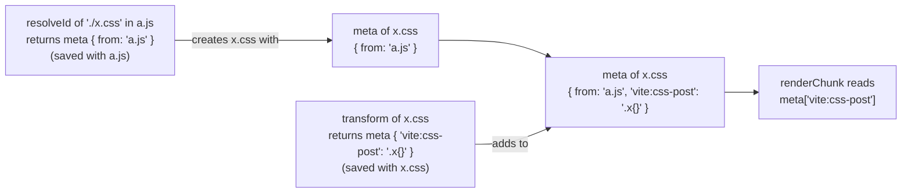
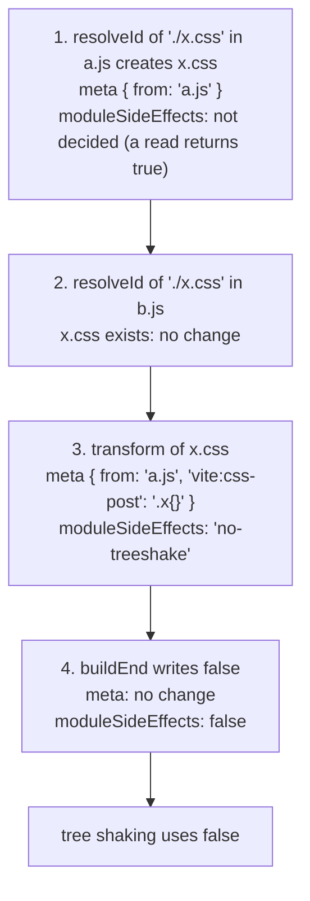

# Module meta and `moduleSideEffects`

A plugin can set two values on a module: its [module meta](../glossary.md)
([docs][meta-docs]) and its `moduleSideEffects` value. A hook sets them, and
a later hook or tree shaking reads them. For example, with the cache work in
[vitejs/vite#24085](https://github.com/vitejs/vite/pull/24085), the
`vite:css-post` plugin returns the CSS of a module as meta in `transform`,
and reads it in `renderChunk`. When the [persistent scan cache](0002-persistent-scan-cache.md)
skips the hooks of a module, these later readers must still get the same
values as in a build without the cache.

The cache saves the values that hooks return, and applies them again on
reuse by the same rules as a build without the cache. It saves two kinds of
values:

- what the `resolveId` hook returns for each import of a module;
- what the module's own `load` and `transform` hooks return.

For example, `a.js` imports `./x.css`. A plugin's `resolveId` hook returns
meta for `./x.css`, and `vite:css-post` adds the CSS in `transform`:



After a restart, neither hook runs. Rolldown takes the first value from the
saved result of `a.js` and the second from the saved result of `x.css`. So
`renderChunk` reads the same meta as in a build without the cache.

If another importer resolves `./x.css` later, its meta is not used. See
[Rules without the cache](#rules-without-the-cache).

In a build without the cache, a module gets these values in three ways.
See [Rules without the cache](#rules-without-the-cache). The cache handles
each way:

| How the module gets the values | What the cache does |
| --- | --- |
| The resolution that creates the module: the `resolveId` hook of an import | Saves it with the importing module. |
| The resolution that creates the module: the `resolveId` hook of an entry, also of a chunk that a hook emits | Saves nothing. Rolldown runs this hook again on every restart. A reused module emits its chunks again from its saved result. |
| The resolution that creates the module: a `this.load` call | Saves nothing. The module of the hook that calls `this.load` gets no saved result, so the hook runs again after a restart. See [0002 Caveats](0002-persistent-scan-cache.md#caveats). |
| The module's own `load` and `transform` hooks | Saves them with the module. |
| Another hook changes them through module info | Saves nothing. A hook that is not part of a [module task](../glossary.md), such as `buildEnd`, runs again after a restart and makes its write again. A [cached hook](../glossary.md) in a module task gives its module no saved result. See [When a module gets no saved result](#when-a-module-gets-no-saved-result). |

Rust plugins keep their meta in a separate store, with other rules. See
[Rust plugins](#rust-plugins).

## Rules without the cache

Status: `proposed`.

The cache must give the same values as a build without the cache, so it
depends on the rules for these values in a build without the cache. The
rules are defined in [Module meta and `moduleSideEffects` — Design][design],
which [rolldown/rolldown#11792][pr-11792] adds to Rolldown. In short:

- **[Creation][design-creation].** The creating resolution of a module is
  the first resolution of its id that reaches the module loader in a build.
  It sets the first `meta` of the module, as a top-level copy, and its first
  `moduleSideEffects`. Later resolutions, `this.resolve`, and the options of
  `this.load` for a module that exists do not change the module.
- **[Hook results][design-hook-results].** Each object result of the
  module's own `load` and `transform` hooks replaces `moduleSideEffects`
  when its value is not `null` or `undefined`, and merges `meta` at the top
  level.
- **[Writes][design-writes].** Any hook can change the values through
  `this.getModuleInfo(id)`. A write of `null` to `moduleSideEffects` clears
  it.
- **[Reading `moduleSideEffects`][design-reading-modulesideeffects].** A
  read returns the decided value. When the value is not decided, it returns
  a default value instead, so a read never returns "not decided". The linked
  section gives the order of the defaults.
- **[Lifetime][design-lifetime].** A full build starts every module with new
  values. A partial scan starts each changed module again from its creating
  resolution.

## Example

The rest of this document uses one example. The entry `main.js` imports
`./a.js` and `./b.js`, and both of them import `./x.css`:

```js
// main.js
import './a.js'
import './b.js'

// a.js and b.js
import './x.css'
```

In this example, the module task of `a.js` ends first. Three plugins set
values for `x.css`:

```js
// A plugin that resolves './x.css' and tells which importer asked first.
resolveId(source, importer) {
  if (source === './x.css') {
    return { id: '/src/x.css', meta: { from: path.basename(importer) } }
  }
},

// vite:css-post, as in vitejs/vite#24085: it keeps the CSS for renderChunk.
transform(code, id) {
  if (id === '/src/x.css') {
    return { code: '', moduleSideEffects: 'no-treeshake', meta: { 'vite:css-post': '.x{}' } }
  }
},

// Another plugin that writes through module info.
buildEnd() {
  this.getModuleInfo('/src/x.css').moduleSideEffects = false
},
```

The values of `x.css` change in four steps:



## Saving and reuse

Status: `proposed`.

The persistent scan cache saves the `meta` and `moduleSideEffects` values
that hooks return. After a restart, it applies them by the rules in
[Rules without the cache](#rules-without-the-cache). So later hooks and tree
shaking get the same values as in a build without the cache.

### What is saved

The values go into two places of the [saved result](../glossary.md) of a
module. See
[0002 What a saved result holds](0002-persistent-scan-cache.md#what-a-saved-result-holds).

- **The resolve result of each import.** For each import of the module,
  Rolldown saves the `meta` and the `moduleSideEffects` that `resolveId` or
  `resolveDynamicImport` returned. They are saved with the importing module,
  because the call runs in its module task.
- **The module's own hook results.** Rolldown saves the `meta` that the
  module's own `load` and `transform` hooks returned, merged as
  [Hook results][design-hook-results] says. It also saves the last
  `moduleSideEffects` value of these hooks that is not `null` or
  `undefined`, or "none" when there is no such value.

Rolldown saves nothing else for these values. A hook that uses them through
module info gives its module no saved result. See
[When a module gets no saved result](#when-a-module-gets-no-saved-result).

In the example, the first build saves these values:

| Saved result of | Part | `meta` | `moduleSideEffects` |
| --- | --- | --- | --- |
| `a.js` | the resolve result of `./x.css` | `{ from: 'a.js' }` | none |
| `b.js` | the resolve result of `./x.css` | `{ from: 'b.js' }` | none |
| `x.css` | its own hook results | `{ 'vite:css-post': '.x{}' }` | `'no-treeshake'` |

The resolve result of `b.js` is saved, although it did not create `x.css`.
Its values do not go into the values of `x.css`, or into the saved result of
`x.css`, because only the resolution that creates a module sets its values,
as [Creation][design-creation] says.

The `false` that `buildEnd` wrote is not saved. `buildEnd` is not part of a
module task, so it runs again after every restart and writes `false` again.

### Reuse

After a restart, a module that reuses its saved result does not run its
hooks. Rolldown applies the saved values in the order of the rules:

1. **Creation.** For each import, the reused module gives its saved resolve
   result to the module loader, in place of a `resolveId` call. The saved
   resolve result reaches the module loader when the module task of the
   reused module ends, at the same time as a resolution that a hook returned
   would. If the saved resolve result is the first resolution of the
   imported id to reach the module loader, it creates the imported module,
   as [Creation][design-creation] says. The imported module then starts with the
   saved `meta` and `moduleSideEffects`. If the imported module already
   exists, the saved resolve result does not change it.
2. **Hook results.** If the imported module also reuses its saved result,
   Rolldown applies its saved own hook results, as
   [Hook results][design-hook-results] says. It merges the saved `meta` into the
   `meta` of the module. The saved `moduleSideEffects` replaces the value,
   unless it is "none".
3. **Writes.** Hooks that are not part of a module task, such as `buildEnd`,
   run again after a restart, and make their writes again.

An entry has no importer. Its `resolveId` call runs again after every
restart, also when the entry reuses its saved result. So an entry starts
with the values of the new call.

In the example, nothing changes, and every module reuses its saved result
after a restart:

| Step | Without the cache | After a restart |
| --- | --- | --- |
| 1 | `resolveId` in `a.js` creates `x.css` with `{ from: 'a.js' }` | The saved resolve result of `a.js` creates `x.css` with `{ from: 'a.js' }` |
| 2 | `resolveId` in `b.js` does not change `x.css` | The saved resolve result of `b.js` does not change `x.css` |
| 3 | `transform` adds `'vite:css-post'` and sets `'no-treeshake'` | The saved result of `x.css` adds `'vite:css-post'` and sets `'no-treeshake'` |
| 4 | `buildEnd` writes `false` | `buildEnd` runs again and writes `false` |

When a module changes, its hooks run again, and the others still reuse
their saved results. The values of `x.css` come from these places:

| `a.js` | `x.css` | Values that `x.css` starts with | Values from the own hooks of `x.css` |
| --- | --- | --- | --- |
| reused | reused | the saved resolve result of `a.js` | the saved result of `x.css` |
| changed | reused | `resolveId` in `a.js`, which runs again | the saved result of `x.css` |
| reused | changed | the saved resolve result of `a.js` | the hooks of `x.css`, which run again |
| changed | changed | `resolveId` in `a.js`, which runs again | the hooks of `x.css`, which run again |

After a restart, the module task of a reused module can end at another time
than in a build without the cache. Then another importer can create the
module. See [Open questions](#open-questions).

Rolldown keeps `moduleSideEffects` only in Rust, so it restores this value
there. `meta` is a JavaScript object. When Rolldown creates the module, it
gives the saved `meta` of the creating resolution and the saved own `meta`
of the module to JavaScript in one call. JavaScript makes the copy and
merges the own `meta` into it. So no hook can read the `meta` of the module
before the saved own `meta` is merged.

### One object in the meta of several modules

Rolldown does not support one object that the `meta` of several modules
holds. A cached hook must give each module its own object. Rolldown does not
check this rule. Each module saves its own copy of its `meta`. So after a
restart, when the modules reuse their saved results, they hold different
objects.

For example, a plugin creates one `icons` array, and its cached `transform`
hook returns it in the `meta` of `a.js` and of `x.css`. Without the cache,
both modules hold this one array, and a change through `a.js` also shows
through `x.css`. After a restart, when `a.js` and `x.css` reuse their saved
results, each module has its own copy, and the change shows only through
`a.js`. So the hook must return a new array for each module, such as
`meta: { icons: [...icons] }`. To change the value for several modules, a
later hook, such as `buildEnd`, changes the `meta` of each module:

```js
for (const id of ['/src/a.js', '/src/x.css']) {
  this.getModuleInfo(id).meta.icons.push('search')
}
```

## When a module gets no saved result

Status: `proposed`.

A module gets no saved result when a hook of its module task has the cache
off. See
[0002 Which modules get a saved result](0002-persistent-scan-cache.md#which-modules-get-a-saved-result).
This section adds the cases for `meta` and `moduleSideEffects`, for a
[cached hook](../glossary.md). In each case, the module of the hook call gets no
saved result, and its hooks run again after every restart. The module of the
hook call is the module whose module task ran the hook: the importing module
for `resolveId` and `resolveDynamicImport`, and the module itself for `load`
and `transform`.

### Use through module info

A cached hook must not read or write `meta` or
`moduleSideEffects` through `this.getModuleInfo(id)`. If it does, the module
of the hook call gets no saved result. This holds for any `id`, also for the
module of the hook call itself. For a Rust plugin, the calls
`get_module_side_effects` and `set_module_side_effects` count as such a use.

The reason is that a saved result holds only what the hooks returned. See
[What is saved](#what-is-saved). A value that a hook reads through module
info can come from outside its module task: from the resolution in another
module task that created the module, or from a write by another hook.
Rolldown does not check these values when it reuses a saved result. A write
through module info is not a returned value, so Rolldown cannot save it and
make it again on reuse.

For example, the `transform` hook of `vite:css-post` can give `x.css` its
CSS in two ways:

```js
// x.css gets no saved result: the hook writes through module info.
handler(code, id) {
  this.getModuleInfo(id).meta['vite:css-post'] = css
  return { code: '' }
}

// x.css gets a saved result: the hook returns the value.
handler(code, id) {
  return { code: '', meta: { 'vite:css-post': css } }
}
```

A read is the same. If the hook reads `this.getModuleInfo(id).meta.from`,
`x.css` gets no saved result, because `from` comes from the resolution in
`a.js`.

A `this.resolve` result is not module info. It holds only the values of its
own resolution, and it does not change a module. Rolldown does not track a
read of it. The host covers it, as
[0002 Caveats](0002-persistent-scan-cache.md#caveats) says.

### Values that cannot be saved

Rolldown saves the `meta` that a hook returns as JSON, one entry for each
top-level key. This holds for `resolveId`, `resolveDynamicImport`, `load`
and `transform`. The module keeps a top-level copy of the returned `meta`,
as [Creation][design-creation] and [Hook results][design-hook-results] say. So only the
keys count, and the returned object itself can be of any kind, such as an
instance of a class.

Each value under a top-level key must be the same after Rolldown writes it
as JSON and reads it back:

| Can be saved | Cannot be saved |
| --- | --- |
| a string, a boolean, `null`, a finite number | a function, a symbol, a `BigInt`, `NaN`, `Infinity`, `-0` |
| an array or a plain object made of these values | a `Map`, a `Set`, a `Date`, an instance of a class, an object without a prototype |
| | `undefined` inside a value: an item or a hole in an array, or the value of a property |
| | a property with a symbol key, or a property that is not enumerable |
| | a getter or a setter, or an object that is frozen, sealed or cannot be extended |
| | an object that is used two times in one `meta`, or that contains itself |

The top-level keys also matter. A `meta` cannot be saved when it has an
enumerable property with a symbol key, or a key that is not well-formed
UTF-16. A `meta` that is not an object, such as a string, cannot be saved
either.

`undefined` can be saved only as the value of a top-level key. Rolldown
saves it, and sets it again on reuse. Deeper inside a value, `undefined`
cannot be saved, because JSON leaves out such a property, and writes such an
item as `null`. For example, `meta: { x: { a: undefined } }` cannot be saved:
after a JSON round trip, `'a' in meta.x` would be `false`.

When a cached hook returns a `meta` that cannot be saved, the
module of the hook call gets no saved result. Rolldown also prints the
warning `PERSISTENT_CACHE_UNSAVABLE_META`. It names the plugin, the hook and
the module. Rolldown prints it at most once for each plugin and hook in a
build, also when many modules have the problem.

For example, if the `transform` hook of `vite:css-post` also returned the
icons of `x.css`:

```js
// x.css gets no saved result, and a warning: JSON turns a Set into {}.
return { code: '', meta: { 'vite:css-post': css, icons: new Set(['home']) } }

// x.css gets a saved result.
return { code: '', meta: { 'vite:css-post': css, icons: ['home'] } }
```

### A call to `this.load`

A cached hook that calls `this.load` also gives the module of
the hook call no saved result. This rule is not only about `meta` and
`moduleSideEffects`, so it is in
[0002 Caveats](0002-persistent-scan-cache.md#caveats).

## Rust plugins

Status: `proposed`.

A Rust plugin keeps its meta in a separate store. A value is a sequence of
bytes that the plugin makes, under a key, for a module id. JavaScript plugins
cannot read this store. A Rust plugin uses it through these calls of its
plugin context:

| Call | What it does |
| --- | --- |
| `set_module_meta(module_id, key, bytes)` | Replaces the value under `key` of the module. The other keys of the module stay. |
| `get_module_meta(module_id, key)` | Returns the value under `key`, from this build or from an earlier one. |
| `has_module_meta_in_this_build(module_id, key)` | Tells whether the value under `key` was set in this build. |
| `module_ids_with_meta(key)`, `count_modules_with_meta(key)` | Return or count the modules whose value under `key` was set in this build. |

These rules differ from the rules for the `meta` of JavaScript plugins.
[Future work](#future-work) lists how they can be aligned.

**Who can set a value.** Any hook can set a value for any module id, at any
time. It can also set a value for a module that exists, not only through the
resolution that creates the module.

**Lifetime.** Rolldown never clears the store, also not in a full build. So a
value can come from an earlier build. Each value keeps the number of the
build that set it last. The calls that ask about "this build" look only at
the values of the current build.

**Saving and reuse.** When a cached hook calls
`set_module_meta` in a module task, Rolldown saves the call with the saved
result of the module of the hook call. The call can be for any module id.
When Rolldown reuses the saved result, it makes the call again, and the value
counts as set in this build. A value is a sequence of bytes, so Rolldown can
always save it. A call in another hook, such as `build_end`, is not saved,
because that hook runs again after a restart.

For example, Vite's reporter plugin counts the modules that `transform`
handled. Its `transform` hook sets a mark on the module, and its `build_end`
hook calls `count_modules_with_meta` for the mark. After a restart with no
change, `transform` does not run. Rolldown makes the saved
`set_module_meta` call again, so the mark is set in this build, and the
count is the same as in a build without the cache.

**Reads.** Rolldown does not track a read of the store, such as a call to
`get_module_meta`. A cached hook that reads the meta of another module still
gives its module a saved result. See [Caveats](#caveats).

## Caveats

In these cases, a later hook can get other values than in a build without
the cache. This breaks
[principle 1](../principles.md#1-caching-must-preserve-correctness). The
reason is that Rolldown does not track these cases when it saves the result.

**A use of module info after the hook call ended.** Rolldown sees a use of
`meta` or `moduleSideEffects` through module info only in the hook call that
got the info object. See [Use through module info](#use-through-module-info).
A plugin can keep the info object, and use it after the hook call ended, for
example in `queueMicrotask` or in a hook call for another module. Rolldown
does not see that use, and the module keeps its saved result.

**A Rust hook that reads meta or `moduleSideEffects` without a tracked
call.** Rolldown tracks a read of `moduleSideEffects` only through
`get_module_side_effects`, and it does not track a read of the meta of Rust
plugins. So a cached Rust hook still gives its module a saved result when
it does one of these:

- It reads the meta of another module, such as with `get_module_meta`.
- It reads `moduleSideEffects` from the `side_effects` field of the info
  that `get_module_info` returns.

When the value changes later, this saved result can be out of date. For
example, the `transform` hook of `a.js` reads a mark from the meta of
`x.css`, and uses it in the code of `a.js`. Then the mark of `x.css`
changes, but `a.js` does not. `a.js` reuses its saved result, with the code
for the old mark. For JavaScript plugins, both reads give the module no saved
result. See [Use through module info](#use-through-module-info).

The Rust plugins are part of Rolldown, so these cases are under the control
of Rolldown. No Rust plugin does either in a cached hook today. Vite's
reporter plugin reads meta only in `module_parsed` and `build_end`, and the
bundle analyzer reads module info only in `generate_bundle`. These hooks are
not cached hooks.

## Open questions

1. **Which importer creates a module after a restart.** In a build without
   the cache, the importer whose module task ends first creates the module,
   as [Creation][design-creation] says. After a restart, a reused importer does not
   run its hooks, so its module task can end at another time than in a
   build without the cache. Then another importer can create the module.
   When a plugin returns other values for the same id to other importers,
   the module starts with other values.

   For example, after a restart `a.js` has changed and runs its hooks
   again, while `b.js` reuses its saved result. If the module task of `b.js`
   now ends first, the saved resolve result of `b.js` creates `x.css` with
   `{ from: 'b.js' }`. In the first build, `x.css` started with
   `{ from: 'a.js' }`.

   Also without the cache, the timing decides which importer creates the
   module, so both values can come from a build without the cache. How
   often the cache changes the result was not tested.

## Future work

1. **Align the meta of Rust plugins with the rules of JavaScript plugins.**

   - **Problem:** The meta of Rust plugins follows other rules than the
     `meta` of JavaScript plugins: who can set a value, how long a value
     lives, and whether Rolldown tracks a read. See
     [Rust plugins](#rust-plugins). An untracked read can leave a saved
     result out of date.
   - **Possible fix:** Use the rules of
     [Rules without the cache](#rules-without-the-cache) and
     [When a module gets no saved result](#when-a-module-gets-no-saved-result)
     for Rust plugins too. Then the build numbers are not needed.

## Verification

The rules in [Rules without the cache](#rules-without-the-cache) are checked
by the tests of
[rolldown/rolldown#11792](https://github.com/rolldown/rolldown/pull/11792).

The cases below use the example. In each case, build once, restart, and
build again. Compare the second build with a build without the cache. A hook
that reads `getModuleInfo(id).meta` and `getModuleInfo(id).moduleSideEffects`
in `buildEnd`, and the output after tree shaking, must be the same.

1. **No change.** Expect that `a.js`, `b.js` and `x.css` reuse their saved
   results, and that no `resolveId` call for `./x.css` and no `transform`
   call for `x.css` runs. `x.css` has the `meta`
   `{ from: 'a.js', 'vite:css-post': '.x{}' }`, and `false` after `buildEnd`.
2. **Second importer.** Expect that the saved resolve result of `b.js` does
   not change `x.css`.
3. **Changed importer.** Change `a.js`, and make the `resolveId` hook return
   other `meta` for the import of `./x.css` in `a.js`. Expect that `x.css` starts with the new values, and still
   gets the saved results of its own hooks.
4. **Changed module.** Change `x.css`. Expect that `x.css` starts with the
   saved resolve result of `a.js`, and that its hooks run again.
5. **Entry.** A `resolveId` hook returns `meta` for the entry `main.js`.
   Expect that the hook runs again after the restart, and that `main.js`
   gets the values of the new call.
6. **Use through module info.** A cached `transform` hook
   reads or writes `getModuleInfo(id).meta` or
   `getModuleInfo(id).moduleSideEffects`, for the module itself and for
   another module. Expect that the module gets no saved result. A read of
   the `meta` of a `this.resolve` result does not have this effect.
7. **Values that cannot be saved.** The `transform` hook returns a `Set` in
   `meta` for one module, and an array for another module. Expect no saved
   result for the first module, a saved result for the second, and one
   `PERSISTENT_CACHE_UNSAVABLE_META` warning.
8. **Partial scan, watch mode and lazy compile.** With the cache on, change
   `x.css` in dev and in watch mode, and fetch a lazily imported module.
   Expect the same values as without the cache.
9. **Rust plugin.** Build with Vite's reporter plugin, and restart. Expect
   the same count of transformed modules. A Rust `resolveId` hook sets meta
   for a module that exists. Restart. Expect that the value is set again.
10. **Performance.** On the benchmark projects, measure a restart with this
    design, and a restart in which every module whose hooks return `meta`
    gets no saved result. Count the time to check, read and write the cache,
    and to pass saved `meta` to JavaScript. Expect that the restart with
    this design is faster
    ([principle 2](../principles.md#2-caching-must-save-more-work-than-it-adds)).

[meta-docs]: https://rolldown.rs/apis/plugin-api/inter-plugin-communication#custom-module-meta-data
[design]: https://github.com/rolldown/rolldown/blob/align-module-options-with-rollup/internal-docs/module-meta-and-side-effects/design.md
[design-creation]: https://github.com/rolldown/rolldown/blob/align-module-options-with-rollup/internal-docs/module-meta-and-side-effects/design.md#creation
[design-hook-results]: https://github.com/rolldown/rolldown/blob/align-module-options-with-rollup/internal-docs/module-meta-and-side-effects/design.md#hook-results
[design-writes]: https://github.com/rolldown/rolldown/blob/align-module-options-with-rollup/internal-docs/module-meta-and-side-effects/design.md#writes
[design-reading-modulesideeffects]: https://github.com/rolldown/rolldown/blob/align-module-options-with-rollup/internal-docs/module-meta-and-side-effects/design.md#reading-modulesideeffects
[design-lifetime]: https://github.com/rolldown/rolldown/blob/align-module-options-with-rollup/internal-docs/module-meta-and-side-effects/design.md#lifetime
[pr-11792]: https://github.com/rolldown/rolldown/pull/11792
