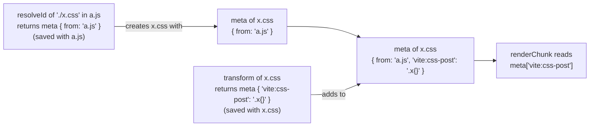
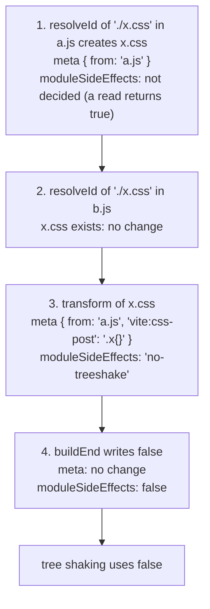
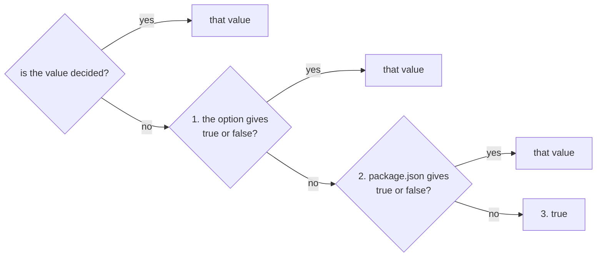

# Module meta and `moduleSideEffects`

A plugin can set two values on a module: its [module meta](../glossary.md)
([docs][meta-docs]) and its `moduleSideEffects` value. A hook sets them, and
a later hook or tree shaking reads them. For example, with the cache work in
[vitejs/vite#24085](https://github.com/vitejs/vite/pull/24085), the
`vite:css-post` plugin returns the CSS of a module as meta in `transform`,
and reads it in `renderChunk`. When the [persistent scan cache](0002-persistent-scan-cache.md)
skips the hooks of a module, these later readers must still get the same
values as in a build without the cache.

The cache saves the values that hooks return, and applies them again on
reuse by the same rules as a build without the cache. It saves two kinds of
values:

- what the `resolveId` hook returns for each import of a module;
- what the module's own `load` and `transform` hooks return.

For example, `a.js` imports `./x.css`. A plugin's `resolveId` hook returns
meta for `./x.css`, and `vite:css-post` adds the CSS in `transform`:



After a restart, neither hook runs. Rolldown takes the first value from the
saved result of `a.js` and the second from the saved result of `x.css`. So
`renderChunk` reads the same meta as in a build without the cache.

If another importer resolves `./x.css` later, its meta is not used. See
[Rules without the cache](#rules-without-the-cache).

In a build without the cache, a module gets these values in three ways.
See [Rules without the cache](#rules-without-the-cache). The cache handles
each way:

| How the module gets the values | What the cache does |
| --- | --- |
| The resolution that creates the module: the `resolveId` hook of an import | Saves it with the importing module. |
| The resolution that creates the module: the `resolveId` hook of an entry, also of a chunk that a hook emits | Saves nothing. Rolldown runs this hook again on every restart. A reused module emits its chunks again from its saved result. |
| The resolution that creates the module: a `this.load` call | Saves nothing. The module of the hook that calls `this.load` gets no saved result, so the hook runs again after a restart. See [0002 Caveats](0002-persistent-scan-cache.md#caveats). |
| The module's own `load` and `transform` hooks | Saves them with the module. |
| Another hook changes them through module info | Saves nothing. A hook that is not part of a [module task](../glossary.md), such as `buildEnd`, runs again after a restart and makes its write again. A [cached hook](../glossary.md) in a module task gives its module no saved result. See [When a module gets no saved result](#when-a-module-gets-no-saved-result). |

Rust plugins keep their meta in a separate store, with other rules. See
[Rust plugins](#rust-plugins).

## Rules without the cache

Status: `proposed`.

The cache must give the same values as a build without the cache, so it
depends on these rules.
[rolldown/rolldown#11792](https://github.com/rolldown/rolldown/pull/11792)
changes Rolldown to follow them. They match Rollup, except for the
differences listed at the end of this section. Here `meta` is the meta of
JavaScript plugins. Rust plugins keep their meta in a separate store. See
[Rust plugins](#rust-plugins).

The rules below use one example. The entry `main.js` imports `./a.js` and
`./b.js`, and both of them import `./x.css`:

```js
// main.js
import './a.js'
import './b.js'

// a.js and b.js
import './x.css'
```

In this example, the module task of `a.js` ends first. Three plugins set
values for `x.css`:

```js
// A plugin that resolves './x.css' and tells which importer asked first.
resolveId(source, importer) {
  if (source === './x.css') {
    return { id: '/src/x.css', meta: { from: path.basename(importer) } }
  }
},

// vite:css-post, as in vitejs/vite#24085: it keeps the CSS for renderChunk.
transform(code, id) {
  if (id === '/src/x.css') {
    return { code: '', moduleSideEffects: 'no-treeshake', meta: { 'vite:css-post': '.x{}' } }
  }
},

// Another plugin that writes through module info.
buildEnd() {
  this.getModuleInfo('/src/x.css').moduleSideEffects = false
},
```

The values of `x.css` change in four steps:



### Creation

Rolldown creates a module when a resolution of its id reaches the module
loader for the first time in a build. A resolution reaches the module loader
at one of these times:

- the `resolveId` call of an entry: at the start of the build, after the
  `resolveId` calls of all entries return and before any import;
- the `resolveId` call of a chunk that a hook emits: when the call returns;
- the `resolveId` or `resolveDynamicImport` call of an import: when the
  module task of the importing module ends, together with the other imports
  of that module;
- a `this.load` call for an id that has no module yet: when the call is
  made. Its `meta` and `moduleSideEffects` options are the values of this
  resolution.

The resolution that creates the module is its
[creating resolution](../glossary.md). It sets two values:

- `meta`: a copy of the `meta` object that the resolution returned. The copy
  is a new object with the same keys. The values under the keys are not
  copied.
- `moduleSideEffects`: the value that the resolution returned, or "not
  decided" when it returned none.

For example, a `resolveId` hook returns `meta: returned`:

```js
const shared = { list: [] }
const returned = { from: 'a.js', shared }

getModuleInfo('/src/x.css').meta === returned       // false: a new object
getModuleInfo('/src/x.css').meta.shared === shared  // true: the same value
```

Later resolutions of the same id, `this.resolve`, and the options of a
`this.load` call for a module that exists do not change the module. A plugin
should return the same values for the same id.

In the example, the module task of `a.js` ends first, so its resolution of
`./x.css` reaches the module loader first. It creates `x.css` with
`{ from: 'a.js' }` (step 1). The resolution from `b.js` comes later, so
`{ from: 'b.js' }` is not used (step 2). This holds also when the
`resolveId` call in `b.js` returns before the one in `a.js`.

### Hook results

After the module is created, its own `load` and `transform` hooks can return
the two values:

- `load`: Rolldown calls the `load` hooks of the plugins in order, and uses
  the first one that returns a result.
- `transform`: Rolldown calls every `transform` hook in order. Each one gets
  the code from the hook before it.

Each of these results that is an object changes the values of the module:

- `moduleSideEffects`: a value that is not `null` or `undefined` replaces the
  current value. `null`, `undefined` or no key keeps the current value.
- `meta`: Rolldown adds each key of the returned `meta` to the `meta` of the
  module, as `Object.assign` does. A key replaces the whole value of the same
  key. Values are not merged deeper. The `meta` of the module stays the same
  object.

A result that is a string has no `meta` and no `moduleSideEffects`, so it
changes nothing.

For example, the `meta` of a module is `{ from: 'a.js', opts: { x: 1 } }`, and
a `transform` hook returns `meta: { opts: { y: 2 } }`. The `meta` becomes
`{ from: 'a.js', opts: { y: 2 } }`. The key `x` is gone, because `opts` is
replaced as a whole.

In the example, the `transform` hook of `vite:css-post` returns
`'no-treeshake'`, which replaces "not decided". It adds the key
`'vite:css-post'` next to `from` (step 3).

### Writes

Any hook can change the values of any module through
`this.getModuleInfo(id)`.

**`meta`.** `getModuleInfo(id).meta` is the `meta` object of the module
itself, so a hook changes the `meta` by changing its keys. Every later reader
sees the change. A later `load` or `transform` result of the module merges
into the same object, as [Hook results](#hook-results) says, so the written
keys stay. For example, a `load` hook writes a key for `x.css` and returns
nothing, and then `transform` returns `meta`:

```js
// a load hook, called for x.css
this.getModuleInfo('/src/x.css').meta.checked = true
// meta of x.css: { from: 'a.js', checked: true }

// the transform hook of vite:css-post returns meta: { 'vite:css-post': '.x{}' }
// meta of x.css: { from: 'a.js', checked: true, 'vite:css-post': '.x{}' }
```

Assigning a new object to the `meta` property does not change the module.
Each `getModuleInfo` call returns a new info object, and its `meta` property
points to the `meta` object of the module. An assignment only makes the
`meta` property of that one info object point to another object:

```js
const info = this.getModuleInfo('/src/x.css')
info.meta = { checked: false }
info.meta.checked                               // false
this.getModuleInfo('/src/x.css').meta.checked   // true: the module did not change
```

**`moduleSideEffects`.** A hook can assign `true`, `false`, `'no-treeshake'`,
`null` or `undefined`. Another value throws. `true`, `false` or
`'no-treeshake'` replaces the current value. The value stays until a later
write, or until a later `load` or `transform` hook of the module returns a
value that is not `null` or `undefined`. `null` or `undefined` clears the
value, and Rolldown treats the module as if no hook had decided it. It does
not go back to a value that a hook returned before the write.
[Reading `moduleSideEffects`](#reading-modulesideeffects) says what Rolldown uses then.

Tree shaking uses the writes that are made up to the end of `buildEnd`. A
write in a later hook, such as `renderChunk`, does not change tree shaking.

In the example, `buildEnd` writes `false`, and tree shaking uses `false`
(step 4). If it wrote `null`, the value would be "not decided" again.
Rolldown would not go back to the `'no-treeshake'` from `transform`, and
[Reading `moduleSideEffects`](#reading-modulesideeffects) would give `true`.

### Reading `moduleSideEffects`

A hook can read `getModuleInfo(id).moduleSideEffects` from the time the
module is created, so the `load` hook of the module can already read it. It
returns the value that tree shaking starts from.

When the module is created, its value is the one that the creating
resolution returned, as [Creation](#creation) says. After that, each hook
result and each write can change it, as [Hook results](#hook-results) and
[Writes](#writes) say. The value is "not decided" when none of them gave a
value, or when a write of `null` or `undefined` cleared it and nothing gave
a value after that.

`getModuleInfo(id).moduleSideEffects` never returns "not decided". When the
value is "not decided", a read returns a value from the
`treeshake.moduleSideEffects` option, from `package.json`, or `true`
instead. A read does not change the value, and it does not check the code of
the module.

Rolldown checks these sources in order, and stops at the first one that
gives a value:



First, if the value is decided, a read returns it. Only when it is "not
decided", Rolldown checks items 1, 2 and 3 in this order, and uses the first
one that gives `true` or `false` for the id:

1. The `treeshake.moduleSideEffects` option:
   - `true`, which is the default, gives nothing for any id. So with the
     default, Rolldown goes on to item 2.
   - `false` gives `false` for every id.
   - An array of ids gives `true` for an id in the array, and `false` for
     any other id.
   - A list of rules gives the value of the first rule that matches the id,
     and nothing when no rule matches.
   - A function gives what it returns, and nothing when it returns `null` or
     `undefined`.
2. The `sideEffects` field of the module's `package.json`. Rolldown reads it
   only for a normal module whose `package.json` it knows: Rolldown's
   resolver found it, or a `resolveId` hook returned `packageJsonPath`. The
   field gives nothing when it says nothing about the path of the module.
3. `true`.

The value is the input of tree shaking, not its result. For example, `true`
from item 3 means that tree shaking checks the statements of the module.

In two cases, when the value is "not decided", a read of
`getModuleInfo(id).moduleSideEffects` returns `true`, but tree shaking does
not use that `true`:

- With `treeshake: false`, Rolldown does not check items 1 and 2. Although a
  read returns `true`, tree shaking is off, and Rolldown keeps every module.
- For an external Node.js built-in, such as `node:fs`, when the option gives
  nothing: although a read returns `true`, tree shaking treats the module as
  having no side effects. So `import 'node:fs'` is removed when nothing from
  it is used.

In the example, the `resolveId` hook in step 1 returns no
`moduleSideEffects`, so `x.css` starts as "not decided". A hook that reads
`getModuleInfo('/src/x.css').moduleSideEffects` between step 1 and step 3
gets `true`. Vite does not set the `treeshake.moduleSideEffects` option, so
the option has the default `true` and gives nothing. Rolldown knows no
`package.json` for `x.css`, because the plugin returned the id without
`packageJsonPath`. After step 3 a read returns `'no-treeshake'`, and after
step 4 it returns `false`.

### Lifetime

What happens to the values in the next build depends on the kind of build.

**A full build** drops the values of every module before `buildStart`. Each
module is then created again, as [Creation](#creation) says. These builds
are full builds:

- a `rolldown()` build;
- each rebuild in watch mode, unless `experimental.incrementalBuild` is on;
- the first build of a dev engine.

**A partial scan** runs the hooks again only for the modules that changed.
It is used for an HMR update, and for a rebuild with
`experimental.incrementalBuild`.

Before the hooks run, each changed module goes back to the values that its
creating resolution gave. Rolldown kept these values when it created the
module. It does not use the result of a new `resolveId` call for them. For
an HMR update, it does not call `resolveId` for the changed module. For an
incremental rebuild, it calls `resolveId` again for the id of the changed
module, without an importer, but it does not use the `meta` or
`moduleSideEffects` of that call. So:

- `meta` becomes a new copy of the `meta` of the creating resolution. Keys
  that hooks wrote, and keys that the last `load` and `transform` results
  added, are gone.
- `moduleSideEffects` becomes the value of the creating resolution again,
  and a value that a hook wrote is dropped.

Then the `load` and `transform` hooks of the module run again and apply
their results, as [Hook results](#hook-results) says. The modules that did
not change keep their values, also the values that writes gave them.

**A lazy compile** creates the real module of a lazily imported module. It
resolves the original import again, and that resolution creates the module,
as [Creation](#creation) says.

In the example, `x.css` changes during dev. An HMR update starts a partial
scan for `x.css` only:

1. `x.css` goes back to the values of the resolution from `a.js`. Its `meta`
   becomes `{ from: 'a.js' }`, and its `moduleSideEffects` becomes "not
   decided". The old CSS under `'vite:css-post'`, and the `false` that
   `buildEnd` wrote, are gone.
2. The `transform` hook of `vite:css-post` runs again. It adds the new CSS
   under `'vite:css-post'`, and sets `moduleSideEffects` to `'no-treeshake'`.

`a.js` and `b.js` did not change. Their hooks do not run again, and their
values stay as they are.

### Differences from Rollup

The rules above match Rollup, except in these points.

**Which importer creates the module.** In Rolldown, the importer whose
module task ends first creates the module. In Rollup, the resolution that
ends first creates it. In the example, if the `resolveId` call in `b.js`
returns before the one in `a.js`, Rollup creates `x.css` with
`{ from: 'b.js' }`. Rolldown still creates it with `{ from: 'a.js' }`,
because the module task of `a.js` ends first.

**`this.resolve` when no hook decided `moduleSideEffects`.** Rolldown returns
`null`. Rollup returns the value of the `treeshake.moduleSideEffects` option
for the id, which is `true` by default. For example,
`this.resolve('./x.css', '/src/a.js')` returns `moduleSideEffects: null` in
Rolldown, and `true` in Rollup. Rolldown reads `package.json` `sideEffects`
only when the value is `null`. Some plugins return a `this.resolve` result
as their own `resolveId` result. If `this.resolve` returned `true`, these
plugins would turn the `package.json` check off.

**`package.json` in a read.** In Rolldown, a read of
`getModuleInfo(id).moduleSideEffects` can return the value of the
`package.json` `sideEffects` field, as
[Reading `moduleSideEffects`](#reading-modulesideeffects) says. Rollup's
core does not read `package.json`. For a module whose `package.json` has
`"sideEffects": false`, a read returns `false` in Rolldown and `true` in
Rollup.

**A write of `null`.** In Rolldown, a write of `null` clears the value, and
tree shaking uses the value from items 1 to 3. Rollup stores `null`, a read
returns `null`, and tree shaking treats it as `false`. In the example, if
`buildEnd` wrote `null`, a read would return `true` in Rolldown and `null`
in Rollup.

**When a write reaches tree shaking.** In Rolldown, tree shaking uses the
writes made up to the end of `buildEnd`, both `true` and `false`. Later
writes do not change tree shaking, because Rolldown links the modules before
the output hooks run. In Rollup, a `false` written as late as `renderStart`
still removes code. But a `true` written in `buildEnd` or later does not
bring removed code back. In the example, the `false` in `buildEnd` reaches
tree shaking in both.

## Saving and reuse

Status: `proposed`.

The persistent scan cache saves the `meta` and `moduleSideEffects` values
that hooks return. After a restart, it applies them by the rules in
[Rules without the cache](#rules-without-the-cache). So later hooks and tree
shaking get the same values as in a build without the cache.

### What is saved

The values go into two places of the [saved result](../glossary.md) of a
module. See
[0002 What a saved result holds](0002-persistent-scan-cache.md#what-a-saved-result-holds).

- **The resolve result of each import.** For each import of the module,
  Rolldown saves the `meta` and the `moduleSideEffects` that `resolveId` or
  `resolveDynamicImport` returned. They are saved with the importing module,
  because the call runs in its module task.
- **The module's own hook results.** Rolldown saves the `meta` that the
  module's own `load` and `transform` hooks returned, merged as
  [Hook results](#hook-results) says. It also saves the last
  `moduleSideEffects` value of these hooks that is not `null` or
  `undefined`, or "none" when there is no such value.

Rolldown saves nothing else for these values. A hook that uses them through
module info gives its module no saved result. See
[When a module gets no saved result](#when-a-module-gets-no-saved-result).

In the example, the first build saves these values:

| Saved result of | Part | `meta` | `moduleSideEffects` |
| --- | --- | --- | --- |
| `a.js` | the resolve result of `./x.css` | `{ from: 'a.js' }` | none |
| `b.js` | the resolve result of `./x.css` | `{ from: 'b.js' }` | none |
| `x.css` | its own hook results | `{ 'vite:css-post': '.x{}' }` | `'no-treeshake'` |

The resolve result of `b.js` is saved, although it did not create `x.css`.
Its values do not go into the values of `x.css`, or into the saved result of
`x.css`, because only the resolution that creates a module sets its values,
as [Creation](#creation) says.

The `false` that `buildEnd` wrote is not saved. `buildEnd` is not part of a
module task, so it runs again after every restart and writes `false` again.

### Reuse

After a restart, a module that reuses its saved result does not run its
hooks. Rolldown applies the saved values in the order of the rules:

1. **Creation.** For each import, the reused module gives its saved resolve
   result to the module loader, in place of a `resolveId` call. The saved
   resolve result reaches the module loader when the module task of the
   reused module ends, at the same time as a resolution that a hook returned
   would. If the saved resolve result is the first resolution of the
   imported id to reach the module loader, it creates the imported module,
   as [Creation](#creation) says. The imported module then starts with the
   saved `meta` and `moduleSideEffects`. If the imported module already
   exists, the saved resolve result does not change it.
2. **Hook results.** If the imported module also reuses its saved result,
   Rolldown applies its saved own hook results, as
   [Hook results](#hook-results) says. It merges the saved `meta` into the
   `meta` of the module. The saved `moduleSideEffects` replaces the value,
   unless it is "none".
3. **Writes.** Hooks that are not part of a module task, such as `buildEnd`,
   run again after a restart, and make their writes again.

An entry has no importer. Its `resolveId` call runs again after every
restart, also when the entry reuses its saved result. So an entry starts
with the values of the new call.

In the example, nothing changes, and every module reuses its saved result
after a restart:

| Step | Without the cache | After a restart |
| --- | --- | --- |
| 1 | `resolveId` in `a.js` creates `x.css` with `{ from: 'a.js' }` | The saved resolve result of `a.js` creates `x.css` with `{ from: 'a.js' }` |
| 2 | `resolveId` in `b.js` does not change `x.css` | The saved resolve result of `b.js` does not change `x.css` |
| 3 | `transform` adds `'vite:css-post'` and sets `'no-treeshake'` | The saved result of `x.css` adds `'vite:css-post'` and sets `'no-treeshake'` |
| 4 | `buildEnd` writes `false` | `buildEnd` runs again and writes `false` |

When a module changes, its hooks run again, and the others still reuse
their saved results. The values of `x.css` come from these places:

| `a.js` | `x.css` | Values that `x.css` starts with | Values from the own hooks of `x.css` |
| --- | --- | --- | --- |
| reused | reused | the saved resolve result of `a.js` | the saved result of `x.css` |
| changed | reused | `resolveId` in `a.js`, which runs again | the saved result of `x.css` |
| reused | changed | the saved resolve result of `a.js` | the hooks of `x.css`, which run again |
| changed | changed | `resolveId` in `a.js`, which runs again | the hooks of `x.css`, which run again |

After a restart, the module task of a reused module can end at another time
than in a build without the cache. Then another importer can create the
module. See [Open questions](#open-questions).

Rolldown keeps `moduleSideEffects` only in Rust, so it restores this value
there. `meta` is a JavaScript object. When Rolldown creates the module, it
gives the saved `meta` of the creating resolution and the saved own `meta`
of the module to JavaScript in one call. JavaScript makes the copy and
merges the own `meta` into it. So no hook can read the `meta` of the module
before the saved own `meta` is merged.

## When a module gets no saved result

Status: `proposed`.

A module gets no saved result when a hook of its module task has the cache
off. See
[0002 Which modules get a saved result](0002-persistent-scan-cache.md#which-modules-get-a-saved-result).
This section adds the cases for `meta` and `moduleSideEffects`, for a
[cached hook](../glossary.md). In each case, the module of the hook call gets no
saved result, and its hooks run again after every restart. The module of the
hook call is the module whose module task ran the hook: the importing module
for `resolveId` and `resolveDynamicImport`, and the module itself for `load`
and `transform`.

### Use through module info

A cached hook must not read or write `meta` or
`moduleSideEffects` through `this.getModuleInfo(id)`. If it does, the module
of the hook call gets no saved result. This holds for any `id`, also for the
module of the hook call itself. For a Rust plugin, the calls
`get_module_side_effects` and `set_module_side_effects` count as such a use.

The reason is that a saved result holds only what the hooks returned. See
[What is saved](#what-is-saved). A value that a hook reads through module
info can come from outside its module task: from the resolution in another
module task that created the module, or from a write by another hook.
Rolldown does not check these values when it reuses a saved result. A write
through module info is not a returned value, so Rolldown cannot save it and
make it again on reuse.

For example, the `transform` hook of `vite:css-post` can give `x.css` its
CSS in two ways:

```js
// x.css gets no saved result: the hook writes through module info.
handler(code, id) {
  this.getModuleInfo(id).meta['vite:css-post'] = css
  return { code: '' }
}

// x.css gets a saved result: the hook returns the value.
handler(code, id) {
  return { code: '', meta: { 'vite:css-post': css } }
}
```

A read is the same. If the hook reads `this.getModuleInfo(id).meta.from`,
`x.css` gets no saved result, because `from` comes from the resolution in
`a.js`.

A `this.resolve` result is not module info. It holds only the values of its
own resolution, and it does not change a module. Rolldown does not track a
read of it. The host covers it, as
[0002 Caveats](0002-persistent-scan-cache.md#caveats) says.

### Values that cannot be saved

Rolldown saves the `meta` that a hook returns as JSON, one entry for each
top-level key. This holds for `resolveId`, `resolveDynamicImport`, `load`
and `transform`. The module keeps a top-level copy of the returned `meta`,
as [Creation](#creation) and [Hook results](#hook-results) say. So only the
keys count, and the returned object itself can be of any kind, such as an
instance of a class.

Each value under a top-level key must be the same after Rolldown writes it
as JSON and reads it back:

| Can be saved | Cannot be saved |
| --- | --- |
| a string, a boolean, `null`, a finite number | a function, a symbol, a `BigInt`, `NaN`, `Infinity`, `-0` |
| an array or a plain object made of these values | a `Map`, a `Set`, a `Date`, an instance of a class, an object without a prototype |
| | an `undefined` item or a hole in an array |
| | a property with a symbol key, or a property that is not enumerable |
| | an object that is used two times in one `meta`, or that contains itself |

The top-level keys also matter. A `meta` cannot be saved when it has an
enumerable property with a symbol key, or a key that is not well-formed
UTF-16. A `meta` that is not an object, such as a string, cannot be saved
either.

`undefined` is handled in two ways. Under a top-level key, Rolldown saves it
and sets it again on reuse. Deeper inside a value, a property with the value
`undefined` is left out, as JSON does. See [Caveats](#caveats).

When a cached hook returns a `meta` that cannot be saved, the
module of the hook call gets no saved result. Rolldown also prints the
warning `PERSISTENT_CACHE_UNSAVABLE_META`. It names the plugin, the hook and
the module. Rolldown prints it at most once for each plugin and hook in a
build, also when many modules have the problem.

For example, if the `transform` hook of `vite:css-post` also returned the
icons of `x.css`:

```js
// x.css gets no saved result, and a warning: JSON turns a Set into {}.
return { code: '', meta: { 'vite:css-post': css, icons: new Set(['home']) } }

// x.css gets a saved result.
return { code: '', meta: { 'vite:css-post': css, icons: ['home'] } }
```

### A call to `this.load`

A cached hook that calls `this.load` also gives the module of
the hook call no saved result. This rule is not only about `meta` and
`moduleSideEffects`, so it is in
[0002 Caveats](0002-persistent-scan-cache.md#caveats).

## Rust plugins

Status: `proposed`.

A Rust plugin keeps its meta in a separate store. A value is a sequence of
bytes that the plugin makes, under a key, for a module id. JavaScript plugins
cannot read this store. A Rust plugin uses it through these calls of its
plugin context:

| Call | What it does |
| --- | --- |
| `set_module_meta(module_id, key, bytes)` | Replaces the value under `key` of the module. The other keys of the module stay. |
| `get_module_meta(module_id, key)` | Returns the value under `key`, from this build or from an earlier one. |
| `has_module_meta_in_this_build(module_id, key)` | Tells whether the value under `key` was set in this build. |
| `module_ids_with_meta(key)`, `count_modules_with_meta(key)` | Return or count the modules whose value under `key` was set in this build. |

These rules differ from the rules for the `meta` of JavaScript plugins.
[Future work](#future-work) lists how they can be aligned.

**Who can set a value.** Any hook can set a value for any module id, at any
time. It can also set a value for a module that exists, not only through the
resolution that creates the module.

**Lifetime.** Rolldown never clears the store, also not in a full build. So a
value can come from an earlier build. Each value keeps the number of the
build that set it last. The calls that ask about "this build" look only at
the values of the current build.

**Saving and reuse.** When a cached hook calls
`set_module_meta` in a module task, Rolldown saves the call with the saved
result of the module of the hook call. The call can be for any module id.
When Rolldown reuses the saved result, it makes the call again, and the value
counts as set in this build. A value is a sequence of bytes, so Rolldown can
always save it. A call in another hook, such as `build_end`, is not saved,
because that hook runs again after a restart.

For example, Vite's reporter plugin counts the modules that `transform`
handled. Its `transform` hook sets a mark on the module, and its `build_end`
hook calls `count_modules_with_meta` for the mark. After a restart with no
change, `transform` does not run. Rolldown makes the saved
`set_module_meta` call again, so the mark is set in this build, and the
count is the same as in a build without the cache.

**Reads.** Rolldown does not track a read of the store with
`get_module_meta`. When a cached hook reads the meta of
another module, the module of the hook call still gets a saved result. When
the other module changes later, this saved result can be out of date. For
example, the `transform` hook of `a.js` reads a mark from the meta of
`x.css`, and uses it in the code of `a.js`. Then the mark of `x.css`
changes, but `a.js` does not. `a.js` reuses its saved result, with the code
for the old mark. For JavaScript plugins, such a read gives the module no
saved result. See [Use through module info](#use-through-module-info).

## Caveats

In these cases, a later hook can get other values than in a build without
the cache. This breaks
[principle 1](../principles.md#1-caching-must-preserve-correctness). The
reason is that Rolldown cannot see these cases when it saves the result.

**A use of module info that Rolldown does not see.** Rolldown sees a use of
`meta` or `moduleSideEffects` through module info only in the hook call that
got the info object. See [Use through module info](#use-through-module-info).
In these cases, Rolldown does not see the use, and the module keeps its
saved result:

- A plugin keeps the info object, and uses it after the hook call ended. For
  example, it uses the object in `queueMicrotask`, or in a hook call for
  another module.
- A Rust plugin reads `moduleSideEffects` from the `side_effects` field of
  the info that `get_module_info` returns. Rolldown sees only the calls
  `get_module_side_effects` and `set_module_side_effects`.

**Values that change in a JSON round trip without a warning.** Rolldown
checks each `meta` value before it saves it. See
[Values that cannot be saved](#values-that-cannot-be-saved). These changes
pass the check:

- A property with the value `undefined` deep inside a value is left out.
  For example, `meta: { x: { a: undefined } }` comes back as `{ x: {} }`
  after a reuse, so `'a' in meta.x` is `false`.
- An object that the `meta` of two modules holds becomes two copies after a
  reuse. For example, a hook returns the same `icons` array in the `meta` of
  `a.js` and of `x.css`. After a reuse, a change to the array of `a.js` does
  not change the array of `x.css`.
- A getter deep inside a value is saved as the value that it returned once.
- A frozen object deep inside a value is not frozen after a reuse.

## Open questions

1. **Which importer creates a module after a restart.** In a build without
   the cache, the importer whose module task ends first creates the module,
   as [Creation](#creation) says. After a restart, a reused importer does not
   run its hooks, so its module task can end at another time than in a
   build without the cache. Then another importer can create the module.
   When a plugin returns other values for the same id to other importers,
   the module starts with other values.

   For example, after a restart `a.js` has changed and runs its hooks
   again, while `b.js` reuses its saved result. If the module task of `b.js`
   now ends first, the saved resolve result of `b.js` creates `x.css` with
   `{ from: 'b.js' }`. In the first build, `x.css` started with
   `{ from: 'a.js' }`.

   Also without the cache, the timing decides which importer creates the
   module, so both values can come from a build without the cache. How
   often the cache changes the result was not tested.

## Future work

1. **Align the meta of Rust plugins with the rules of JavaScript plugins.**

   - **Problem:** The meta of Rust plugins follows other rules than the
     `meta` of JavaScript plugins: who can set a value, how long a value
     lives, and whether Rolldown tracks a read. See
     [Rust plugins](#rust-plugins). An untracked read can leave a saved
     result out of date.
   - **Possible fix:** Use the rules of
     [Rules without the cache](#rules-without-the-cache) and
     [When a module gets no saved result](#when-a-module-gets-no-saved-result)
     for Rust plugins too. Then the build numbers are not needed.

## Verification

The rules in [Rules without the cache](#rules-without-the-cache) are checked
by the tests of
[rolldown/rolldown#11792](https://github.com/rolldown/rolldown/pull/11792).

The cases below use the example. In each case, build once, restart, and
build again. Compare the second build with a build without the cache. A hook
that reads `getModuleInfo(id).meta` and `getModuleInfo(id).moduleSideEffects`
in `buildEnd`, and the output after tree shaking, must be the same.

1. **No change.** Expect that `a.js`, `b.js` and `x.css` reuse their saved
   results, and that no `resolveId` call for `./x.css` and no `transform`
   call for `x.css` runs. `x.css` has the `meta`
   `{ from: 'a.js', 'vite:css-post': '.x{}' }`, and `false` after `buildEnd`.
2. **Second importer.** Expect that the saved resolve result of `b.js` does
   not change `x.css`.
3. **Changed importer.** Change `a.js`, and make the `resolveId` hook return
   other `meta` for the import of `./x.css` in `a.js`. Expect that `x.css` starts with the new values, and still
   gets the saved results of its own hooks.
4. **Changed module.** Change `x.css`. Expect that `x.css` starts with the
   saved resolve result of `a.js`, and that its hooks run again.
5. **Entry.** A `resolveId` hook returns `meta` for the entry `main.js`.
   Expect that the hook runs again after the restart, and that `main.js`
   gets the values of the new call.
6. **Use through module info.** A cached `transform` hook
   reads or writes `getModuleInfo(id).meta` or
   `getModuleInfo(id).moduleSideEffects`, for the module itself and for
   another module. Expect that the module gets no saved result. A read of
   the `meta` of a `this.resolve` result does not have this effect.
7. **Values that cannot be saved.** The `transform` hook returns a `Set` in
   `meta` for one module, and an array for another module. Expect no saved
   result for the first module, a saved result for the second, and one
   `PERSISTENT_CACHE_UNSAVABLE_META` warning.
8. **Partial scan, watch mode and lazy compile.** With the cache on, change
   `x.css` in dev and in watch mode, and fetch a lazily imported module.
   Expect the same values as without the cache.
9. **Rust plugin.** Build with Vite's reporter plugin, and restart. Expect
   the same count of transformed modules. A Rust `resolveId` hook sets meta
   for a module that exists. Restart. Expect that the value is set again.
10. **Performance.** On the benchmark projects, measure a restart with this
    design, and a restart in which every module whose hooks return `meta`
    gets no saved result. Count the time to check, read and write the cache,
    and to pass saved `meta` to JavaScript. Expect that the restart with
    this design is faster
    ([principle 2](../principles.md#2-caching-must-save-more-work-than-it-adds)).

[meta-docs]: https://rolldown.rs/apis/plugin-api/inter-plugin-communication#custom-module-meta-data
